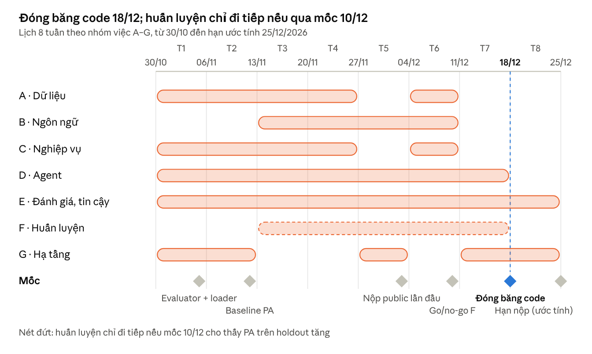

<!-- Generated reading copy; the DOCX remains the planning source. -->
# Timeline DataMate theo nh?m vi?c A?G

B?n ??c tr?n GitHub t? [Timeline DataMate theo nhóm việc A–G.docx](<Timeline DataMate theo nhóm việc A–G.docx>). N?i dung v?n b?n/b?ng gi? theo ngu?n; m?c ng?y l? d? ki?n trong t?i li?u, kh?ng ph?i x?c nh?n l?ch BTC m?i.

SHA-256 DOCX: `e74b1292119f01ca3eae7d20d709921219efc30e655e01909685c50d5363eb51`.

Timeline DataMate theo nhóm việc A–G

Nov 3, 2026 · @Quinnie

Tổng quan

Kế hoạch 8 tuần, từ 30/10 đến hạn ước tính 25/12/2026, chia thành T1–T8, mỗi tuần bắt đầu từ thứ Sáu. Hôm nay 03/11 đang ở T1. Phân công gợi ý cho đội 4 người: người 1 làm A + G, người 2 làm D + B, người 3 làm C và phần thời gian của B, người 4 làm E + F.

timeline 8 tuần · 7 nhóm việc, 6 mốc

Sáu mốc chung: evaluator + loader 05/11, baseline PA 12/11, nộp public lần đầu 03/12, go/no-go cho huấn luyện 10/12, đóng băng code 18/12, hạn nộp ước tính 25/12.

## A. Xử lý và hiểu dữ liệu

Trọng tâm ở T1–T4: dữ liệu sạch và hồ sơ schema phải có trước khi đầu tư vào agent. Thư mục: ingest/, profile/.

Mục đích của nhóm

- Vì sao cần: dữ liệu mỗi hộ nằm trong nhiều định dạng và rất bẩn. LLM không thể làm việc trực tiếp trên một file Excel lộn xộn. Mọi bước phía sau đều chạy trên dữ liệu do A tạo ra.

- Giúp gì cho hệ thống: biến file thô thành bảng sạch, truy vấn được trong DuckDB. Kèm theo là một hồ sơ mô tả từng hộ (bảng, cột, vai trò cột, thực thể, phạm vi thời gian), đóng vai trò "bản đồ" cho agent.

- Nếu thiếu: agent viết SQL trên những cột tên vô nghĩa, cộng chuỗi 1.200.000đ thì báo lỗi hoặc ra số sai, đếm cả dòng tổng. Kết quả là sai hàng loạt và khó phát hiện. Ở private test, loại hình mới sẽ làm hệ thống vỡ ngay từ bước đọc file.

| Tuần | Việc cần làm | Vấn đề nghiên cứu | Xong khi |
| --- | --- | --- | --- |
| T1 (30/10–05/11) | Script khảo sát train: file, số dòng, cột, README mỗi hộ. Loader CSV/XLSX/SQLite → DuckDB nguyên trạng, cache theo business_id | Train thực tế có những kiểu file và kiểu bẩn nào | Mọi business nạp được, không lỗi |
| T2 (06–12/11) | Profile thô: bảng, cột, kiểu, giá trị mẫu, min/max, tỷ lệ null. Dò encoding (kể cả TCVN3/VNI), tìm dòng header thật | Cách mã hóa bảng cho LLM (SpreadsheetLLM); phát hiện vùng bảng (TableSense) | Hồ sơ schema được dùng trong prompt baseline |
| T3 (13–19/11) | Chuẩn hóa số, ngày, giá trị thiếu, đơn vị (ghi ra bảng mới, giữ bảng gốc). Bỏ dòng tổng, khử dòng trùng | Phân biệt dd/mm và mm/dd dựa trên cả cột; dấu chấm và phẩy mơ hồ | Mỗi bộ làm sạch có unit test; PA không giảm |
| T4 (20–26/11) | Nhận vai trò cột từ giá trị; tìm khóa nối giữa bảng; từ điển thực thể mỗi hộ; phạm vi thời gian dữ liệu | Semantic column type (Sherlock, Doduo); join và inclusion dependency discovery | Nhóm lỗi "schema" và "tên" trong phân tích lỗi giảm |
| T5 (27/11–03/12) | Gắn cờ "không có dữ liệu" (khoảng thời gian, thực thể) để verify/ phân biệt 0 với thiếu | Cách nhận biết thiếu dữ liệu so với giá trị bằng 0 | Hồ sơ có cờ thiếu dữ liệu, verify/ dùng được |
| T6 (04–10/12) | Chạy trên holdout loại hình mới, sửa những chỗ vỡ | Tổng quát hóa sang loại hình chưa gặp | Không business holdout nào lỗi khi nạp |
| T7–T8 | Chỉ sửa lỗi |  |  |

Mục đích từng công việc

- Khảo sát train (T1): nhìn dữ liệu thật trước khi viết code, để biết loại bẩn nào thật sự có. Nhờ vậy không làm thừa những bộ xử lý vô ích và không bỏ sót loại lỗi phổ biến.

- Loader → DuckDB, cache (T1): tạo một giao diện truy vấn chung cho CSV, XLSX và SQLite, để agent chỉ cần viết SQL. Cache giúp không phải nạp lại ở mỗi câu hỏi, tiết kiệm thời gian chạy. Nạp nguyên trạng để luôn giữ bản gốc mà đối chiếu.

- Profile thô (T2): LLM không tự nhìn được dữ liệu. Hồ sơ là phần mô tả đưa vào prompt, cho LLM biết bảng nào có cột gì và giá trị trông ra sao. Không có hồ sơ, LLM sẽ đoán tên cột.

- Dò encoding, tìm header thật (T2): sai encoding thì tên sản phẩm thành ký tự rác, không khớp được với câu hỏi. Sai header thì cột mang tên Unnamed: 0, còn dòng tiêu đề bị tính như dữ liệu.

- Chuẩn hóa số, ngày, giá trị thiếu, đơn vị (T3): để phép cộng, phép lọc theo ngày và phép so sánh cho kết quả đúng. Ghi ra bảng mới và giữ bảng gốc, để có thể sửa luật làm sạch mà không mất dữ liệu.

- Bỏ dòng tổng, khử dòng trùng (T3): dòng tổng và dòng trùng làm tổng phình lên, có khi gấp đôi. Đây là loại lỗi "sai nhưng trông hợp lý", không gây exception nên rất khó thấy.

- Vai trò cột từ giá trị (T4): tên cột như sl, dg và README đều không đáng tin. Biết cột nào là số lượng, đơn giá, thành tiền hay ngày giúp agent chọn đúng cột.

- Khóa nối giữa bảng (T4): nhiều câu hỏi cần ghép bảng, ví dụ đơn hàng với sản phẩm. Nối sai khóa sẽ nhân bản dòng và làm tổng sai.

- Từ điển thực thể (T4): giúp "cf sữa" khớp được với "Cà phê sữa". Đây là nền cho bước liên kết của D và bước khớp tên của B.

- Phạm vi thời gian (T4): biết dữ liệu bắt đầu và kết thúc khi nào, để nhận ra câu hỏi hỏi ngoài phạm vi, tức câu không trả lời được.

- Cờ thiếu dữ liệu (T5): phân biệt "bán được 0" với "không có dữ liệu". Cờ này quyết định trả lời 0 hay abstain, và nhầm thì bị trừ điểm.

- Chạy trên holdout loại hình mới (T6): private test có loại hình chưa từng gặp. Kiểm tra trước để biết loader và profile có tổng quát hay chỉ chạy được với train.

- Chỉ sửa lỗi (T7–T8): giữ hệ thống ổn định, tránh đưa lỗi mới vào sát hạn.

Chủ đề để tìm hiểu

Từ khóa tiếng Anh cho kết quả tốt nhất khi tìm paper, blog và video.

| Công việc | Dạng | Chủ đề | Từ khóa tìm kiếm | Tài liệu nền tảng |
| --- | --- | --- | --- | --- |
| Khảo sát train | Kỹ thuật | Exploratory data analysis, data profiling | exploratory data analysis pandas; ydata-profiling | Abedjan, Golab, Naumann, Profiling Relational Data: A Survey (VLDB Journal 2015) |
| Loader → DuckDB, cache | Kỹ thuật | Data ingestion, embedded analytical database | DuckDB read_csv auto detection; DuckDB excel extension; ETL pipeline python | Tài liệu chính thức của DuckDB |
| Profile thô | Kỹ thuật | Data profiling, biểu diễn schema cho LLM | schema representation text-to-SQL prompt; table serialization LLM | SpreadsheetLLM (Tian et al., 2024) |
| Dò encoding, tìm header | Kỹ thuật + nghiên cứu | Character encoding detection; table detection trong spreadsheet | charset detection python; TCVN3 to Unicode converter; table detection spreadsheets; header row detection | TableSense (Dong et al., AAAI 2019) |
| Chuẩn hóa số, ngày, đơn vị | Kỹ thuật | Data cleaning, data wrangling, type inference | data cleaning pipeline; date format inference; locale-aware number parsing | Wrangler (Kandel et al., CHI 2011) |
| Bỏ dòng tổng, khử trùng | Kỹ thuật | Deduplication, phát hiện cấu trúc spreadsheet | data deduplication; spreadsheet summary row detection | Auto-Tables (Li et al., VLDB 2023) |
| Vai trò cột từ giá trị | Nghiên cứu | Semantic column type annotation | semantic type detection; column type annotation LLM | Sherlock (Hulsebos et al., KDD 2019); Doduo (Suhara et al., SIGMOD 2022) |
| Khóa nối giữa bảng | Nghiên cứu | Join discovery, foreign key và inclusion dependency discovery | foreign key discovery; inclusion dependency discovery; joinable table search | LSH Ensemble (Zhu et al., VLDB 2016) |
| Từ điển thực thể | Kỹ thuật + nghiên cứu | Entity resolution, entity normalization | entity resolution; entity matching; fuzzy string matching rapidfuzz | Ditto (Li et al., VLDB 2021) |
| Phạm vi thời gian | Kỹ thuật | Temporal profiling | data coverage time range; data freshness check |  |
| Cờ thiếu dữ liệu | Nghiên cứu (nhẹ) | Ngữ nghĩa của dữ liệu thiếu, data completeness | missing data vs zero; MCAR MAR MNAR; data completeness checks |  |
| Holdout loại hình mới | Nghiên cứu | Domain generalization, out-of-distribution evaluation | domain generalization; out-of-distribution robustness |  |

## B. Ngôn ngữ tiếng Việt

Bắt đầu từ T3, sau khi baseline cho thấy câu hỏi gây sai ở đâu. Thư mục: understand/. Danh sách các dạng câu hỏi được thu thập ở T1 (phần thống kê của E).

Mục đích của nhóm

- Vì sao cần: câu hỏi do người thật gõ nên thường không dấu, viết tắt, văn nói, và dùng thời gian tương đối. Trong khi đó dữ liệu và rulebook lại viết có dấu, đầy đủ.

- Giúp gì cho hệ thống: chuyển câu hỏi thành dạng có cấu trúc gồm ý định, thực thể đã chuẩn hóa, khoảng ngày cụ thể và kiểu đáp án. Nhờ đó, bước liên kết và bước tính toán làm việc trên thông tin rõ ràng.

- Nếu thiếu: mô hình nhỏ phải tự đoán "cf sua thang truoc" nghĩa là gì. Nó dễ sai tháng, sai sản phẩm, hoặc trả sai kiểu, ví dụ 0,15 thay vì 15%.

| Tuần | Việc cần làm | Vấn đề nghiên cứu | Xong khi |
| --- | --- | --- | --- |
| T3 (13–19/11) | Chuẩn hóa câu hỏi: bảng viết tắt, khôi phục dấu bằng luật kết hợp từ điển thực thể | Vietnamese diacritic restoration; dùng chính LLM hay một mô hình nhỏ riêng | Câu hỏi được chuẩn hóa đúng trên bộ mẫu kiểm tra |
| T4 (20–26/11) | Tách biểu thức thời gian → khoảng ngày cụ thể theo as_of_date, gồm cả âm lịch (làm cùng C) | Temporal expression normalization (TimeML, HeidelTime); quy ước tuần và dịp Tết | Mọi dạng thời gian gặp trong train đều có unit test |
| T5 (27/11–03/12) | Đoán kiểu đáp án; nhận diện câu mơ hồ và câu không trả lời được | Ambiguity trong text-to-SQL (AmbiQT); unanswerable questions (TriageSQL) | Độ đúng của việc đoán kiểu đáp án được đo trên train |
| T6 (04–10/12) | Khớp thực thể phía câu hỏi với từ điển của A, theo cả hai chiều | Fuzzy matching tiếng Việt, character n-gram | Nhóm lỗi "tên" giảm |
| T7–T8 | Chỉ sửa lỗi |  |  |

Mục đích từng công việc

- Bảng viết tắt, khôi phục dấu (T3): để từ ngữ trong câu hỏi khớp được với tên trong dữ liệu và trong rulebook. Từ điển thực thể của A được dùng làm gợi ý, nên tên riêng của từng hộ được khôi phục đúng như cách dữ liệu viết.

- Biểu thức thời gian → khoảng ngày (T4): "tháng trước", "tuần này", "dịp Tết" đều phụ thuộc vào as_of_date và lịch. Việc này tính bằng code tất định thay vì để LLM tự tính, vì mô hình nhỏ hay tính sai ngày. Quên as_of_date là nguồn sai hàng loạt nguy hiểm nhất.

- Đoán kiểu đáp án (T5): formatter và bước kiểm tra cần biết đáp án là số, phần trăm, ngày hay danh sách. Sai kiểu thì bị chấm sai dù con số đúng.

- Nhận diện câu mơ hồ, câu không trả lời được (T5): báo sớm cho bước kiểm tra để abstain, thay vì trả lời bừa rồi bị trừ điểm.

- Khớp thực thể hai chiều (T6): tên trong câu hỏi và tên trong dữ liệu đều bẩn. Khớp tốt thì lọc đúng sản phẩm hoặc khách hàng; khớp sai thì ra kết quả rỗng hoặc sai đối tượng.

- Chỉ sửa lỗi (T7–T8): giữ ổn định trước hạn.

Chủ đề để tìm hiểu

| Công việc | Dạng | Chủ đề | Từ khóa tìm kiếm | Tài liệu nền tảng |
| --- | --- | --- | --- | --- |
| Bảng viết tắt, khôi phục dấu | Kỹ thuật + nghiên cứu | Vietnamese text normalization, diacritic restoration | Vietnamese diacritic restoration; Vietnamese accent restoration; abbreviation expansion | Tìm theo từ khóa: có nhiều paper và repo tiếng Việt cho bài này |
| Biểu thức thời gian → khoảng ngày | Kỹ thuật | Temporal expression recognition and normalization | temporal expression normalization; TimeML TIMEX3; HeidelTime; SUTime; Duckling time parser | HeidelTime (Strötgen & Gertz, 2010); SUTime (Chang & Manning, LREC 2012) |
| Đoán kiểu đáp án | Nghiên cứu | Question classification, answer type prediction | question classification; answer type prediction | Learning Question Classifiers (Li & Roth, COLING 2002) |
| Câu mơ hồ, câu không trả lời được | Nghiên cứu | Ambiguity và unanswerable detection | ambiguous text-to-SQL; unanswerable question detection | AmbiQT (Bhaskar et al., 2023); TriageSQL (Zhang et al., 2020); SQuAD 2.0 (Rajpurkar et al., ACL 2018) |
| Khớp thực thể hai chiều | Kỹ thuật + nghiên cứu | Entity linking, fuzzy matching | entity linking; character n-gram similarity; rapidfuzz | Ditto (Li et al., VLDB 2021) |

## C. Tri thức nghiệp vụ

Chạy song song với A từ T1, vì lịch và định nghĩa sai sẽ làm sai hàng loạt câu hỏi. Thư mục: knowledge/, compute/domain_lib/.

Mục đích của nhóm

- Vì sao cần: cùng một câu "doanh thu tháng này" có thể có nhiều cách tính. Có trừ đơn hủy không? Tính theo ngày đặt hay ngày giao? Tuần bắt đầu từ thứ mấy? BTC chốt các định nghĩa này trong rulebook, và đáp án tham chiếu được tính theo đúng rulebook. Rulebook có thể khác giữa các split.

- Giúp gì cho hệ thống: đảm bảo mọi câu hỏi được tính theo đúng định nghĩa của BTC, nhất quán giữa các câu, và tự thích ứng khi rulebook thay đổi.

- Nếu thiếu: agent tính theo cách "thông thường" trông có vẻ hợp lý nhưng lệch định nghĩa. Lỗi này có hệ thống: mọi câu dùng chỉ số đó đều sai, và chỉ nhìn con số thì không phát hiện được.

| Tuần | Việc cần làm | Vấn đề nghiên cứu | Xong khi |
| --- | --- | --- | --- |
| T1 (30/10–05/11) | Đọc rulebook.md, viết thành checklist định nghĩa. Tiện ích lịch từ calendar.csv: tuần, tháng, cùng kỳ, cửa sổ Tết | Rulebook có thể khác ở những điểm nào giữa các split | Có checklist; tiện ích lịch có unit test |
| T2 (06–12/11) | domain_lib bản đầu: doanh thu hợp lệ, số lượng bán, lọc đơn hủy và trả | Semantic layer, metrics layer (cách dbt, Cube định nghĩa chỉ số) | Baseline gọi được các hàm này |
| T3 (13–19/11) | Chuyển rulebook thành định nghĩa có cấu trúc (YAML), đọc lúc chạy, không hardcode | External knowledge trong text-to-SQL (trường evidence của BIRD) | Đổi rulebook mà không phải sửa code |
| T4 (20–26/11) | Mở rộng domain_lib theo kết quả phân tích lỗi: giá vốn, lợi nhuận, bán chạy, tăng trưởng, so sánh theo kỳ | Hàm nào agent cần nhất (dựa trên error_analysis.py) | Mỗi hàm có test; agent dùng đúng hàm |
| T6 (04–10/12) | Thử với rulebook biến thể (tự sửa vài định nghĩa) để kiểm tra tính tổng quát | Hệ thống phản ứng ra sao khi định nghĩa đổi | PA ổn định, không vỡ khi rulebook đổi |
| T5, T7–T8 | Hỗ trợ D và E, sửa lỗi |  |  |

Mục đích từng công việc

- Đọc rulebook, viết thành checklist (T1): rulebook là "đề bài thật" của phần tính toán, vì đáp án tham chiếu được tính theo nó. Đọc kỹ để hiểu chính xác BTC định nghĩa doanh thu, bán chạy, tuần, giá vốn, Tết ra sao. Checklist biến văn bản thành danh sách điều kiện kiểm tra được, dùng làm đầu vào cho domain_lib, unit test và prompt. Việc đọc sớm cũng giúp tìm ra chỗ mơ hồ để hỏi BTC kịp thời.

- Tiện ích lịch từ calendar.csv (T1): mọi câu hỏi có yếu tố thời gian đều đi qua đây. Ngày Tết đổi theo từng năm và không tự tính chính xác được, còn calendar.csv là nguồn chuẩn của BTC. Viết bằng code tất định thì đúng tuyệt đối và luôn tái lập.

- domain_lib bản đầu (T2): đóng gói định nghĩa thành hàm. Agent gọi hàm doanh thu thay vì tự viết lại logic lọc đơn hủy, đơn trả ở mỗi câu. Nhờ vậy ít chỗ sai hơn, prompt ngắn hơn, và kết quả nhất quán.

- Rulebook có cấu trúc, đọc lúc chạy (T3): rulebook thay đổi giữa các split. Nếu hardcode, private test dùng rulebook khác sẽ sai toàn bộ. Tham số hóa giúp hệ thống tự thích ứng.

- Mở rộng domain_lib theo phân tích lỗi (T4): chỉ thêm những hàm mà lỗi thật cho thấy là cần, tránh làm thừa. Mỗi hàm có test, để một lỗi nhỏ trong hàm không gây sai hàng loạt.

- Thử với rulebook biến thể (T6): giả lập tình huống split mới đổi định nghĩa, để kiểm chứng rằng việc "không hardcode" thật sự hoạt động.

- Hỗ trợ D và E, sửa lỗi (T5, T7–T8): nghiệp vụ là chỗ D và E hay cần hỏi lại; người làm C giải đáp và sửa hàm khi phân tích lỗi chỉ ra.

Chủ đề để tìm hiểu

| Công việc | Dạng | Chủ đề | Từ khóa tìm kiếm | Tài liệu nền tảng |
| --- | --- | --- | --- | --- |
| Đọc rulebook, viết checklist | Kỹ thuật (phân tích nghiệp vụ) | Business requirements analysis, business glossary, định nghĩa KPI | business glossary; KPI definition; metric definition retail | Trường evidence trong BIRD (Li et al., NeurIPS 2023) là ví dụ gần nhất |
| Tiện ích lịch từ calendar.csv | Kỹ thuật | Date dimension (calendar table), lịch âm Việt Nam | date dimension table; calendar table data warehouse; ISO week; thuật toán âm lịch Việt Nam | Kimball, The Data Warehouse Toolkit (phần date dimension); thuật toán âm lịch của Hồ Ngọc Đức |
| domain_lib bản đầu | Kỹ thuật | Semantic layer, metrics layer, thiết kế DSL | semantic layer; dbt metrics; Cube semantic layer; domain-specific language analytics | Tài liệu dbt Semantic Layer và Cube |
| Rulebook có cấu trúc | Kỹ thuật + nghiên cứu | Knowledge-augmented text-to-SQL, configuration-driven rules | external knowledge text-to-SQL; BIRD evidence; rule engine python | BIRD (Li et al., NeurIPS 2023) |
| Mở rộng domain_lib theo lỗi | Kỹ thuật | Error-driven development, unit testing | error analysis machine learning; pytest fixtures | Bài giảng error analysis của Andrew Ng (Machine Learning Yearning) |
| Thử rulebook biến thể | Nghiên cứu | Robustness testing, metamorphic testing | metamorphic testing; robustness text-to-SQL perturbation | Dr.Spider (Chang et al., ICLR 2023) |

## D. Hệ thống suy luận (agent)

Đây là nhóm cho PA tăng nhiều nhất, chạy từ T1 đến T7. Mỗi chiến lược mới là một file trong ground/ hoặc compute/, được so sánh với bản cũ bằng cách đổi config. Thư mục: ground/, compute/, infra/llm.py.

Mục đích của nhóm

- Vì sao cần: đây là phần biến câu hỏi và dữ liệu thành con số đáp án. A, B, C chuẩn bị nguyên liệu; D là nơi thực sự giải câu hỏi.

- Giúp gì cho hệ thống: chọn đúng bảng, cột, giá trị (liên kết), sinh và chạy truy vấn hoặc code, tự sửa khi gặp lỗi, và tạo tín hiệu tin cậy cho E.

- Nếu thiếu hoặc yếu: dữ liệu sạch đến đâu cũng không thành đáp án. Mọi câu hỏi đều đi qua D, nên agent yếu là nguồn mất điểm lớn nhất.

| Tuần | Việc cần làm | Vấn đề nghiên cứu | Xong khi |
| --- | --- | --- | --- |
| T1 (30/10–05/11) | Chọn mô hình ≤15B ban đầu, chạy trên vLLM (cùng G). Thử bằng tay khoảng 20 câu | Mô hình code/SQL nào mạnh nhất ở cỡ này | 20 câu chạy được từ đầu đến cuối |
| T2 (06–12/11) | Baseline single_sql: toàn bộ schema + rulebook + câu hỏi → một câu SQL → chạy | Cách sắp xếp ngữ cảnh trong prompt cho mô hình nhỏ | Có PA baseline (mốc 12/11, cùng E) |
| T3 (13–19/11) | Vòng sửa lỗi khi SQL lỗi; schema linking để chỉ đưa bảng, cột liên quan | DIN-SQL, CHESS, RESDSQL | Tỷ lệ code lỗi giảm; prompt ngắn lại |
| T4 (20–26/11) | Chiến lược mới: agent viết code gọi domain_lib theo vòng ReAct, chạy trong sandbox | ReAct, Self-Debugging, Binder, Chain-of-Table | Biết chiến lược nào có PA cao hơn trên train và holdout |
| T5 (27/11–03/12) | Truy xuất giá trị và khớp thực thể trong ground/; lấy K mẫu rồi bỏ phiếu theo kết quả thực thi | Value retrieval; Self-Consistency, execution-based voting | Có tín hiệu đồng thuận để E dùng cho abstain |
| T6 (04–10/12) | Router chọn đường nhanh hay đường suy luận sâu; tối ưu prompt và số bước | Cân bằng độ chính xác và thời gian chạy | Toàn bộ test chạy vừa giới hạn thời gian |
| T7 (11–17/12) | Chốt cấu hình, chỉ tinh chỉnh tham số (K, số bước, temperature) |  | Cấu hình cuối được ghi vào configs/ |
| T8 | Đóng băng |  |  |

Mục đích từng công việc

- Chọn mô hình ≤15B, chạy trên vLLM, thử 20 câu bằng tay (T1): luật thi giới hạn cỡ mô hình. Thử sớm bằng tay để biết mô hình làm được gì và hỏng ở đâu trước khi dựng khung. Dùng ngay mô hình sẽ nộp, để tránh bất ngờ khi chuyển từ mô hình lớn xuống.

- Baseline single_sql (T2): đường chạy xuyên suốt đơn giản nhất để có PA đầu tiên. Mọi cải tiến sau đều so với con số này, và baseline tạo ra lỗi thật để phân tích.

- Vòng sửa lỗi (T3): mô hình nhỏ hay viết sai cú pháp hoặc sai tên cột. Đưa thông báo lỗi lại cho mô hình tự sửa thường cứu được nhiều câu với chi phí thấp.

- Schema linking (T3): đưa toàn bộ schema làm prompt rất dài, mô hình nhỏ bị nhiễu và chọn sai cột. Chỉ đưa bảng và cột liên quan giúp chính xác hơn và chạy nhanh hơn.

- ReAct gọi domain_lib, chạy trong sandbox (T4): câu hỏi nhiều bước như tăng trưởng hay xếp hạng có điều kiện rất khó viết trong một câu SQL. Gọi hàm nghiệp vụ đã có test giúp giảm lỗi logic. Sandbox giữ cho code sinh ra không làm hỏng hệ thống và luôn có giới hạn thời gian. So sánh với single_sql bằng config để chỉ giữ chiến lược tốt hơn.

- Truy xuất giá trị, khớp thực thể (T5): một câu SQL đúng cấu trúc nhưng lọc theo 'cf sữa' sẽ trả về rỗng. Phải lấy đúng giá trị đang có trong dữ liệu.

- K mẫu và bỏ phiếu (T5): chọn đáp án mà đa số các mẫu cùng cho ra, giúp tăng độ đúng. Mức đồng thuận giữa các mẫu cũng là tín hiệu tin cậy để E quyết định abstain.

- Router đường nhanh và đường sâu (T6): câu dễ không cần nhiều bước ReAct. Router tiết kiệm thời gian để toàn bộ test vừa giới hạn, và dành thời gian cho câu khó.

- Chốt cấu hình (T7): tránh thay đổi lớn sát hạn. Tham số được ghi trong config để kết quả tái lập được.

- Đóng băng (T8): không thay đổi gì nữa, để bản nộp đúng là bản đã đánh giá.

Chủ đề để tìm hiểu

| Công việc | Dạng | Chủ đề | Từ khóa tìm kiếm | Tài liệu nền tảng |
| --- | --- | --- | --- | --- |
| Chọn mô hình, chạy vLLM | Kỹ thuật | LLM serving, chọn mô hình | vLLM serving; BIRD leaderboard; small code LLM comparison | vLLM / PagedAttention (Kwon et al., SOSP 2023) |
| Baseline single_sql | Kỹ thuật | Text-to-SQL prompting | text-to-SQL prompt engineering; zero-shot text-to-SQL | DAIL-SQL (Gao et al., VLDB 2024) |
| Vòng sửa lỗi | Nghiên cứu | Self-correction, execution feedback | self-debugging LLM; execution feedback code generation | Self-Debugging (Chen et al., ICLR 2024); DIN-SQL (Pourreza & Rafiei, NeurIPS 2023) |
| Schema linking | Nghiên cứu | Schema linking, schema pruning | schema linking text-to-SQL; schema pruning | RESDSQL (Li et al., AAAI 2023); CHESS (Talaei et al., 2024) |
| ReAct gọi domain_lib, sandbox | Nghiên cứu + kỹ thuật | LLM agent, tool use, code-as-action, sandboxed execution | ReAct agent; tool learning LLM; program-aided language models; code as action; python code sandbox | ReAct (Yao et al., ICLR 2023); PAL (Gao et al., ICML 2023); CodeAct (Wang et al., ICML 2024); Binder (Cheng et al., ICLR 2023); Chain-of-Table (Wang et al., ICLR 2024) |
| Truy xuất giá trị, khớp thực thể | Nghiên cứu | Database value retrieval | value retrieval text-to-SQL; LSH entity retrieval | CHESS (Talaei et al., 2024); CodeS (Li et al., SIGMOD 2024) |
| K mẫu và bỏ phiếu | Nghiên cứu | Self-consistency, execution-based selection | self-consistency; execution-guided decoding; execution-based voting | Self-Consistency (Wang et al., ICLR 2023) |
| Router đường nhanh, đường sâu | Nghiên cứu + kỹ thuật | LLM routing, adaptive compute | LLM routing; query difficulty estimation; adaptive inference budget | RouteLLM (Ong et al., 2024) |
| Chốt cấu hình | Kỹ thuật | Hyperparameter tuning, quản lý config | hydra config; experiment tracking |  |

## E. Độ tin cậy và đánh giá

Nhóm này chạy suốt 8 tuần và giữ phần lớn các mốc. Mỗi tuần nên có một báo cáo PA cùng các nguyên nhân sai hàng đầu. Thư mục: eval/, verify/, format/.

Mục đích của nhóm

- Vì sao cần: không đo thì không biết thay đổi nào thật sự tốt hơn. PA trừ điểm khi trả lời sai, nên biết lúc nào nên im lặng cũng quan trọng như trả lời đúng.

- Giúp gì cho hệ thống: là thước đo cho mọi nhóm khác, chỉ ra chỗ đang mất điểm, chặn đáp án sai trước khi nộp, và đảm bảo đáp án đúng định dạng.

- Nếu thiếu: đội làm theo cảm tính, một "cải tiến" có thể làm giảm điểm mà không ai biết. Trả lời bừa bị trừ điểm. Con số đúng nhưng định dạng sai vẫn mất điểm. Và đội sẽ bị bất ngờ ở private test.

| Tuần | Việc cần làm | Vấn đề nghiên cứu | Xong khi |
| --- | --- | --- | --- |
| T1 (30/10–05/11) | scorer.py đúng luật BTC (đã có), run_eval.py. Thống kê câu hỏi train: kiểu đáp án, tỷ lệ unanswerable, dạng thời gian, dạng viết tắt | Luật so khớp chính xác cho từng kiểu đáp án (còn chờ BTC xác nhận) | Mốc 05/11: evaluator và loader chạy trên toàn bộ train |
| T2 (06–12/11) | Chạy baseline, báo PA theo kiểu và theo hộ; định dạng log từng câu (cùng G) |  | Mốc 12/11: có PA baseline |
| T3 (13–19/11) | error_analysis.py gắn nhãn nguyên nhân sai; split_holdout.py giữ lại vài loại hình kinh doanh | Phân loại lỗi đủ chi tiết để biết nên sửa nhóm nào | Có báo cáo lỗi đầu tiên; có holdout |
| T4 (20–26/11) | Kiểm tra hợp lý trong verify/ (âm, quá lớn, rỗng, mâu thuẫn với hồ sơ); formatter riêng cho từng kiểu đáp án | Answer normalization (cách SQuAD, TAT-QA chuẩn hóa số) | Không còn lỗi định dạng trên train |
| T5 (27/11–03/12) | Điểm tin cậy từ đồng thuận K mẫu và các kiểm tra; chọn ngưỡng abstain để PA cao nhất | Selective prediction, calibration, semantic entropy | Mốc 03/12: nộp public test lần đầu |
| T6 (04–10/12) | Đánh giá trên holdout; so sánh điểm train và public | Khoảng cách giữa train và loại hình mới | Mốc 10/12: quyết định go/no-go cho F |
| T7 (11–17/12) | repro_check.py (cùng G); chốt ngưỡng abstain |  | Hai lần chạy cho PA lệch trong mức cho phép |
| T8 (18–25/12) | Đánh giá bản đóng băng lần cuối |  | Có báo cáo PA của bản nộp |

Mục đích từng công việc

- scorer.py và run_eval.py (T1): chấm giống hệt BTC thì điểm nội bộ mới phản ánh điểm thật. Chấm sai luật thì cả đội tối ưu nhầm hướng.

- Thống kê câu hỏi train (T1): biết phân bố kiểu đáp án, tỷ lệ câu không trả lời được, các dạng thời gian và viết tắt, để ưu tiên đúng chỗ. Đây cũng là đầu vào cho B.

- Báo PA baseline, log từng câu (T2): có mốc để so sánh mọi thay đổi. Log là công cụ debug chính: với mỗi câu sai, xem được code sinh ra và kết quả trung gian.

- error_analysis.py (T3): gắn nhãn nguyên nhân sai (schema, tên, thời gian, rulebook, định dạng, code lỗi, lẽ ra nên abstain) để biết nhóm nào cần đầu tư tiếp. Kết quả này cũng là đầu vào cho F.

- split_holdout.py theo loại hình (T3): train chỉ chứa các loại hình đã biết. Giữ lại vài loại hình để giả lập private test, tránh ảo tưởng điểm cao do hệ thống học thuộc.

- Kiểm tra hợp lý trong verify/ (T4): bắt các lỗi "sai nhưng trông hợp lý", như doanh thu âm, lớn hơn tổng năm, hay kết quả rỗng. Những lỗi này không gây exception nên chỉ kiểm tra chủ động mới bắt được.

- Formatter theo từng kiểu (T4): đúng số nhưng sai đơn vị, sai làm tròn, nhầm phần trăm với tỷ lệ, sai thứ tự danh sách đều bị chấm sai. Formatter tất định sửa triệt để loại lỗi này.

- Điểm tin cậy và ngưỡng abstain (T5): PA trừ điểm câu sai, nên bỏ qua những câu không chắc chắn sẽ làm tăng tổng điểm. Ngưỡng được chọn bằng dữ liệu để PA cao nhất, không chọn theo cảm giác.

- Đánh giá holdout, so sánh train với public (T6): đo khoảng cách tổng quát hóa. Kết quả này là căn cứ để quyết định go/no-go cho F.

- repro_check.py, chốt ngưỡng (T7): luật yêu cầu kết quả tái lập. Hai lần chạy lệch nhau nhiều có thể khiến bài bị loại.

- Đánh giá bản đóng băng (T8): biết chắc chất lượng bản nộp, và chắc rằng không có thay đổi vô tình nào lọt vào.

Chủ đề để tìm hiểu

| Công việc | Dạng | Chủ đề | Từ khóa tìm kiếm | Tài liệu nền tảng |
| --- | --- | --- | --- | --- |
| scorer.py, run_eval.py | Kỹ thuật | Evaluation harness, exact-match metric | LLM evaluation harness; exact match answer normalization | Cách chấm của SQuAD (Rajpurkar et al., EMNLP 2016) |
| Thống kê câu hỏi train | Kỹ thuật | Dataset analysis, question taxonomy | dataset analysis; question taxonomy |  |
| Báo PA, log từng câu | Kỹ thuật | Experiment tracking, LLM observability | experiment tracking MLflow; LLM tracing; structured logging |  |
| error_analysis.py | Kỹ thuật + nghiên cứu | Error analysis, failure taxonomy | error analysis machine learning; text-to-SQL error taxonomy | Andrew Ng, Machine Learning Yearning (các chương về error analysis) |
| split_holdout.py | Nghiên cứu | Cross-domain evaluation | cross-domain evaluation; leave-one-domain-out | Cách chia cross-database của Spider (Yu et al., EMNLP 2018) |
| Kiểm tra hợp lý | Kỹ thuật | Data validation, output validation | data validation; Great Expectations; LLM output validation | Tài liệu Great Expectations |
| Formatter theo kiểu | Kỹ thuật | Answer normalization cho số, đơn vị | numeric answer evaluation; answer normalization | TAT-QA (Zhu et al., ACL 2021) |
| Điểm tin cậy, ngưỡng abstain | Nghiên cứu | Selective prediction, calibration, uncertainty quantification | selective prediction; LLM uncertainty estimation; semantic entropy; conformal abstention | Language Models (Mostly) Know What They Know (Kadavath et al., 2022); Semantic Uncertainty (Kuhn et al., ICLR 2023); Know Your Limits (Wen et al., 2024) |
| Đánh giá holdout, go/no-go | Nghiên cứu | Generalization gap, distribution shift | generalization gap; distribution shift evaluation |  |
| repro_check.py | Kỹ thuật | Reproducibility, deterministic inference | deterministic LLM inference; vLLM seed reproducibility | Xem dòng "Seed và sinh tất định" ở G |
| Đánh giá bản đóng băng | Kỹ thuật | Regression testing cho ML | ML regression testing |  |

## F. Huấn luyện mô hình

Đây là nhánh có điều kiện. Nó chỉ đi tiếp sau mốc 10/12 nếu mô hình fine-tune cho PA trên holdout cao hơn mô hình gốc; nếu không, giữ mô hình gốc. Thư mục: training/, models/.

Mục đích của nhóm

- Vì sao cần: luật giới hạn mô hình ở mức ≤15B. Mô hình nhỏ chưa quen với dữ liệu hộ kinh doanh Việt Nam, câu hỏi không dấu, và cách gọi domain_lib của đội.

- Giúp gì cho hệ thống: dạy mô hình đúng việc của bài: đọc hồ sơ, gọi đúng hàm, trả đúng định dạng. Fine-tune có thể lấy lại những điểm mà chỉnh prompt không sửa được.

- Nếu thiếu: hệ thống vẫn chạy được với mô hình gốc, nên F là nhánh tùy chọn. Bỏ F thì có thể mất phần điểm chỉ fine-tune mới lấy được. Ngược lại, làm F tốn GPU và thời gian, và dễ học thuộc train, nên cần mốc go/no-go.

| Tuần | Việc cần làm | Vấn đề nghiên cứu | Xong khi |
| --- | --- | --- | --- |
| T3 (13–19/11) | So sánh 2–3 mô hình nền ≤15B bằng chính pipeline hiện tại trên train | Mô hình code/SQL cỡ nhỏ (ví dụ họ OmniSQL); giấy phép có hợp lệ với luật thi không | Chọn được mô hình nền |
| T4 (20–26/11) | Sinh dữ liệu: business giả lập theo nhiều loại hình, câu hỏi tiếng Việt, đáp án tính bằng code | Synthetic text-to-SQL data, SQL-to-question back-translation | Bộ dữ liệu có đáp án đã kiểm chứng |
| T5 (27/11–03/12) | Thu quỹ đạo agent đúng: chạy nhiều lần, chỉ giữ lời giải cho đáp án đúng | Rejection sampling để tạo dữ liệu SFT | Có tập SFT sạch |
| T6 (04–10/12) | SFT bằng LoRA, đánh giá trên holdout | LoRA SFT trên quỹ đạo; RL với phần thưởng thực thi (Arctic-Text2SQL-R1) | Mốc 10/12: go/no-go |
| T7 (11–17/12) | Nếu đạt: gộp trọng số, lượng tử hóa, kiểm tra tốc độ và tái lập | Lượng tử hóa không làm mất độ chính xác | models/ có bản cuối, hoặc quyết định giữ mô hình gốc |
| T1–T2, T8 | Không làm |  |  |

Mục đích từng công việc

- So sánh mô hình nền (T3): chọn điểm xuất phát tốt nhất cho chính pipeline này, không dựa vào benchmark chung. Kiểm tra giấy phép để tránh bị loại vì dùng mô hình không hợp lệ.

- Sinh dữ liệu giả lập (T4): dữ liệu train thật ít và chỉ có vài loại hình. Dữ liệu giả với nhiều loại hình giúp mô hình tổng quát hóa sang loại hình mới. Đáp án được tính bằng code nên chắc chắn đúng.

- Thu quỹ đạo đúng (T5): dạy mô hình bằng chính những lời giải đúng của hệ thống mình, đúng cách gọi hàm và đúng định dạng. Chỉ giữ lời giải cho đáp án đúng, để mô hình không học theo lỗi.

- SFT bằng LoRA, đánh giá holdout (T6): LoRA rẻ, nhanh và đủ cho mô hình ≤15B. Đánh giá trên holdout để chắc mô hình tổng quát hóa chứ không học thuộc. Kết quả quyết định mốc go/no-go 10/12.

- Gộp trọng số, lượng tử hóa, kiểm tra tốc độ và tái lập (T7): cần làm để đưa mô hình vào Docker và chạy kịp giới hạn thời gian. Lượng tử hóa có thể làm giảm độ chính xác, nên phải đo lại PA sau khi lượng tử hóa.

- Không làm ở T1–T2, T8: khi chưa có phân tích lỗi thì chưa biết nên luyện gì, còn sát hạn thì không đủ thời gian để kiểm chứng.

Chủ đề để tìm hiểu

| Công việc | Dạng | Chủ đề | Từ khóa tìm kiếm | Tài liệu nền tảng |
| --- | --- | --- | --- | --- |
| So sánh mô hình nền | Nghiên cứu | Chọn mô hình, benchmark LLM nhỏ cho code và SQL | small LLM text-to-SQL; OmniSQL; code LLM benchmark | OmniSQL (2025); CodeS (Li et al., SIGMOD 2024) |
| Sinh dữ liệu giả lập | Nghiên cứu | Synthetic data generation cho text-to-SQL | synthetic text-to-SQL data; SQL-to-question back-translation; LLM data synthesis | Bộ dữ liệu SynSQL trong OmniSQL (2025) |
| Thu quỹ đạo đúng | Nghiên cứu | Rejection sampling fine-tuning, agent trajectory distillation | rejection sampling fine-tuning; STaR self-taught reasoner; agent trajectory SFT | STaR (Zelikman et al., NeurIPS 2022); FireAct (Chen et al., 2023) |
| SFT bằng LoRA, có thể thêm RL | Nghiên cứu + kỹ thuật | Parameter-efficient fine-tuning, RL với phần thưởng thực thi | LoRA fine-tuning; QLoRA; GRPO; RL text-to-SQL execution reward | LoRA (Hu et al., ICLR 2022); QLoRA (Dettmers et al., NeurIPS 2023); Arctic-Text2SQL-R1 (2025) |
| Gộp trọng số, lượng tử hóa | Kỹ thuật | Model merging, quantization | merge LoRA weights; AWQ quantization; GPTQ; vLLM quantization | AWQ (Lin et al., MLSys 2024); GPTQ (Frantar et al., ICLR 2023) |

## G. Hạ tầng và vận hành

Nhóm này làm dồn ở đầu (T1–T2), giữa (T5) và cuối (T7–T8). Hỏng ở đây là mất toàn bộ điểm. Thư mục: infra/, runner.py, Dockerfile, configs/.

Mục đích của nhóm

- Vì sao cần: điểm chỉ được tính khi BTC chạy được bài nộp trên máy của họ, với Docker, không có mạng, có giới hạn thời gian, và yêu cầu kết quả tái lập.

- Giúp gì cho hệ thống: đảm bảo mọi thứ các nhóm khác làm ra thật sự chạy được trong môi trường chấm. Đồng thời cung cấp log, cache và tốc độ cho cả đội.

- Nếu thiếu: hệ thống tốt đến đâu cũng có thể nhận 0 điểm, vì image lỗi, chạy quá giờ, thiếu dòng kết quả, hoặc kết quả không tái lập.

| Tuần | Việc cần làm | Vấn đề nghiên cứu | Xong khi |
| --- | --- | --- | --- |
| T1 (30/10–05/11) | Repo, môi trường, khóa phiên bản thư viện; thư mục /data giống của BTC; vLLM chạy mô hình; runner.py dạng khung | Cấu hình vLLM cho mô hình ≤15B trên phần cứng chấm | runner.py chạy xuyên suốt với kết quả giả |
| T2 (06–12/11) | tracing/ ghi submission và log từng câu; cache theo business_id; seed và sinh tất định | Sinh tất định trên vLLM | Mọi id đều có dòng kết quả, kể cả khi lỗi |
| T5 (27/11–03/12) | throughput.py: đo số câu mỗi giờ, ước lượng cho private test; chạy song song theo business | Batching, prefix caching | Biết chắc private test vừa giới hạn thời gian |
| T7 (11–17/12) | Dockerfile có sẵn trọng số; chạy với --network none; repro_check.py (cùng E) | Đóng gói offline, khóa phiên bản | Image chạy offline cho cùng PA |
| T8 (18–25/12) | Đóng băng code 18/12; nộp trước hạn ít nhất 48 giờ; chỉ sửa lỗi nghiêm trọng |  | Bản cuối đã nộp |
| T3–T4, T6 | Hỗ trợ các nhóm khác, theo dõi thời gian chạy |  |  |

Mục đích từng công việc

- Repo, môi trường, khóa phiên bản (T1): cả đội chạy trên cùng một môi trường, tránh tình trạng "máy tôi chạy được". Khóa phiên bản là điều kiện để kết quả tái lập.

- Thư mục /data giống BTC, runner.py dạng khung (T1): phát hiện sớm sai lệch về đường dẫn và định dạng đầu vào, đầu ra. Khung chạy xuyên suốt cho các nhóm khác cắm module vào ngay từ đầu.

- vLLM chạy mô hình (T1): D cần mô hình chạy được để bắt đầu thử nghiệm.

- tracing/ (T2): mọi id phải có dòng kết quả. Thiếu dòng có thể bị mất điểm hoặc làm bài nộp không hợp lệ. Log từng câu là nguyên liệu cho phân tích lỗi của E.

- Cache theo business_id (T2): mỗi hộ chỉ nạp và profile một lần rồi dùng cho mọi câu hỏi của hộ đó, giúp tiết kiệm thời gian chạy.

- Seed và sinh tất định (T2): là điều kiện để kết quả tái lập. Làm muộn thì rất khó sửa, vì nhiều module đã phụ thuộc vào cách sinh cũ.

- throughput.py (T5): biết sớm hệ thống có kịp giới hạn thời gian không, để D còn kịp chỉnh K và số bước. Phát hiện muộn thì không còn thời gian tối ưu.

- Dockerfile, chạy --network none, repro_check.py (T7): giả lập đúng môi trường chấm. Mọi thứ, từ trọng số đến thư viện, phải có sẵn trong image.

- Đóng băng, nộp trước hạn 48 giờ (T8): chừa thời gian xử lý sự cố khi nộp, và tránh lỗi phút chót.

- Hỗ trợ các nhóm khác (T3–T4, T6): theo dõi thời gian chạy khi các module mới được ghép vào, để phát hiện sớm module nào làm chậm hệ thống.

Chủ đề để tìm hiểu

Toàn bộ nhóm G là kỹ thuật, nên tài liệu chính là docs chính thức và blog kỹ thuật thay vì paper.

| Công việc | Dạng | Chủ đề | Từ khóa tìm kiếm | Tài liệu nền tảng |
| --- | --- | --- | --- | --- |
| Repo, môi trường, khóa phiên bản | Kỹ thuật | Dependency management, reproducible environment | uv lock; poetry lock; pip-tools; reproducible python environment | Tài liệu uv hoặc Poetry |
| /data giống BTC, runner.py | Kỹ thuật | Thiết kế batch inference pipeline | batch inference pipeline; ML pipeline design |  |
| vLLM chạy mô hình | Kỹ thuật | LLM serving | vLLM; PagedAttention; OpenAI-compatible server | vLLM / PagedAttention (Kwon et al., SOSP 2023) |
| tracing/ | Kỹ thuật | Structured logging, LLM observability | structured logging python; JSON lines logging; LLM tracing |  |
| Cache theo business_id | Kỹ thuật | Caching, memoization | memoization python; DuckDB persistent database |  |
| Seed và sinh tất định | Kỹ thuật + nghiên cứu | Tính tất định của LLM inference | LLM inference nondeterminism; batch invariance; temperature 0 nondeterministic | Blog Defeating Nondeterminism in LLM Inference (Thinking Machines, 2025) |
| throughput.py | Kỹ thuật | Inference optimization | continuous batching; prefix caching vLLM; LLM throughput benchmark |  |
| Dockerfile, chạy không mạng | Kỹ thuật | Containerization, air-gapped deployment | docker multi-stage build; air-gapped docker; NVIDIA container toolkit |  |
| Đóng băng, nộp sớm | Kỹ thuật | Release management | code freeze; release checklist |  |

Phụ thuộc, rủi ro và điều chỉnh

Đường găng của kế hoạch là E và G (T1–T2) → A và C (T1–T4) → D (T3–T6) → abstain (T5). F chỉ chạy song song và không chặn bản nộp.

Phụ thuộc chính

- D cần hồ sơ schema của A và domain_lib của C. Nếu A trễ, D vẫn chạy baseline trên schema thô.

- Abstain của E (T5) cần K mẫu và tín hiệu đồng thuận của D (T5).

- F cần phân tích lỗi của E để biết nên luyện gì, và quỹ đạo đúng của D để làm dữ liệu.

- B và C cùng làm phần biểu thức thời gian ở T4.

Rủi ro và phương án dự phòng

| Rủi ro | Dấu hiệu | Phương án |
| --- | --- | --- |
| Baseline trễ quá 12/11 | Chưa có PA vào cuối T2 | Cắt bớt A còn loader thô; mọi người dồn vào đường chạy xuyên suốt |
| Chiến lược ReAct không hơn single_sql | PA ở T4 không tăng | Giữ single_sql cộng vòng sửa lỗi; chuyển công sức sang ground/ |
| Fine-tune không giúp | PA holdout không tăng ở mốc 10/12 | Bỏ F, dùng mô hình gốc; người làm F chuyển sang E và D |
| Chạy quá giới hạn thời gian | Ước lượng ở T5 vượt giới hạn | Giảm K, giảm số bước, dùng router đường nhanh nhiều hơn |
| Kết quả không tái lập | repro_check.py lệch ở T7 | Tắt lấy mẫu ngẫu nhiên, cố định seed, khóa lại phiên bản |

Khi có lịch chính thức của BTC

Hạn 25/12 hiện là ước tính. Khi BTC công bố lịch, giữ nguyên thứ tự và dời ba mốc theo lịch thật: nộp public lần đầu (đang là 03/12), đóng băng code (một tuần trước hạn), và nộp bản cuối (ít nhất 48 giờ trước hạn).
