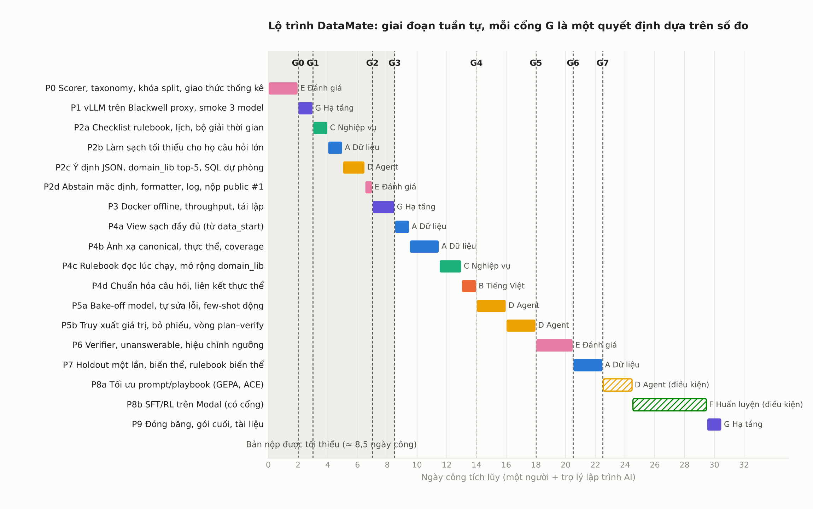

<!-- Generated by scripts/timeline.py; DOCX remains the planning source. -->
# Timeline DataMate theo nhóm việc A–G

Bản đọc từ [DOCX hiện hành](<Timeline DataMate theo nhóm việc A–G.docx>). Các nhận định, nguồn nghiên cứu và model trong tài liệu là nội dung kế hoạch; cần xác minh trước khi áp dụng. Trạng thái triển khai nằm trong [state](../docs/project_state.md) và [backlog](../tasks/backlog.json).

SHA-256 DOCX: `b70f5e852b156c7ff0835eebbdd96ccb71b718fd095fd797b554efe5b1837219`.

Timeline DataMate theo nhóm việc A–G

Lộ trình cho một người, theo giai đoạn có cổng kiểm chứng

Cập nhật 05/11/2026, sau khi hoàn tất A-T2 (source 790b1af, main bd00615). Thay kế hoạch ngày 03/11 (@Quinnie, DOCX SHA-256 e74b1292…5eb51). Theo xác nhận của chủ project: đội 1 người; được đưa dữ liệu BTC lên Modal; thời gian không phải ràng buộc chính. Cần chủ project duyệt trước khi cập nhật docs/project_state.md và tasks/backlog.json.

## 0. Tóm tắt

Giả định của bản này: một người làm toàn bộ, có trợ lý lập trình AI; mọi model thật chạy trên Modal (được phép dùng dữ liệu BTC); ưu tiên chất lượng và độ chắc chắn hơn tốc độ. Vì vậy lộ trình được xếp theo thứ tự giá trị và rủi ro, không theo tuần, và đo bằng ngày công, không bằng ngày lịch.

Năm quyết định chính:

Tuần tự, mỗi giai đoạn kết thúc bằng một cổng có số đo (G0–G7). Thứ tự: đo lường → model chạy được → lát cắt xuyên suốt → đóng gói → mở rộng dữ liệu/nghiệp vụ theo lỗi → đường LLM → độ tin cậy → tổng quát hóa → (có điều kiện) tối ưu và huấn luyện. Một người không thể làm song song bảy nhóm như bảng phân công 4 người của kế hoạch 03/11.

Kiến trúc hai pha "thư viện dựng offline, model nhỏ dùng lúc chạy". Lúc phát triển, người + trợ lý AI mạnh dựng thư viện hàm nghiệp vụ, playbook và ví dụ từ dữ liệu dev; lúc suy luận, model ≤ 15B chỉ chọn và gọi các hàm đó, LLM sinh SQL/Python là đường dự phòng. Đây đúng là cách hệ thống đứng đầu DABstep đạt kết quả cao với model nhỏ (mục 2).

Không tin sẵn kỹ thuật nào. Các nguồn mâu thuẫn nhau về self-consistency, schema linking và chế độ suy luận (thinking); mọi kỹ thuật đi vào sổ thí nghiệm (mục 7), chỉ giữ khi tăng PA có ý nghĩa thống kê trên dev.

Độ tin cậy có từ bản đầu tiên: abstain mặc định, verifier, formatter theo type. Luật chấm PA thưởng độ chính xác trên câu đã trả lời hơn độ phủ.

F (huấn luyện) quay lại như nhánh có điều kiện, vì thời gian không còn là ràng buộc; nhưng chỉ chạy sau khi tối ưu prompt/playbook (rẻ hơn nhiều) đã chững lại, và phải qua cổng riêng.

Ước lượng (chưa đo, cho một người): lõi P0–P7 + P9 khoảng 23,5 ngày công; nhánh có điều kiện P8 thêm 6–8 ngày công. Bản nộp được tối thiểu (qua cổng G3) sau khoảng 8,5 ngày công; từ đó mọi cải tiến đều nằm trên một pipeline luôn nộp được.

Giữ nguyên, không làm lại: A-T1 (khảo sát + loader/cache), khảo sát sâu train, A-T2 đầy đủ (profile, schema descriptor, policy encoding/delimiter lúc chạy, text QA, header và data_start), nền G (uv/lock, CLI, validator, fake runner, CI CPU, Modal CPU smoke), contract registry, và phần "mục đích" của từng nhóm trong kế hoạch 03/11.

Lịch BTC để tham khảo (contract đọc từ portal 01/11): hạn gói giải pháp 16/11/2026 23:59, private 20–23/11. Theo yêu cầu, bản này không lấy lịch này làm ràng buộc. Nếu cần nộp theo lịch đó, làm đúng thứ tự P0 → P3 rồi nộp; thứ tự này được chọn để luôn có bản nộp được sớm nhất.

### Thay đổi so với kế hoạch ngày 03/11

| Chủ đề | Kế hoạch 03/11 | Bản này | Lý do |
| --- | --- | --- | --- |
| Đơn vị kế hoạch | 8 tuần lịch, 4 người song song | Giai đoạn tuần tự, ngày công, 1 người | Đội thực tế 1 người |
| Kiến trúc | single_sql → ReAct → router | Thư viện hàm dựng offline + model nhỏ gọi hàm; LLM SQL/Python dự phòng; abstain | DABstep, DS-STAR, nghiên cứu lớp ngữ nghĩa, TrustSQL |
| Độ tin cậy | Abstain ở T5, formatter T4 | Có từ lát cắt đầu (P2) | Luật chấm phạt câu sai |
| Đóng gói Docker | T7 | Ngay sau lát cắt xuyên suốt (P3) | Một người: mọi cải tiến phải nằm trên bản nộp được |
| Chọn model | T1 thử tay, F-T3 so sánh | P1 smoke trên GPU Blackwell proxy, P5 bake-off trên pipeline | Danh sách 2026 mới; phải kiểm phần cứng sm_120 |
| Huấn luyện F | T3–T7, go/no-go 10/12 | Có điều kiện sau P7; tối ưu prompt/playbook trước | GEPA/ACE rẻ hơn và đã cho kết quả tốt; RL ít dữ liệu khả thi |
| Split/holdout | T3 | P0, trước mọi lựa chọn | Tránh rò rỉ khi chọn cấu hình |

## 1. Căn cứ

### 1.1 Luật thi ảnh hưởng tới thiết kế

| Hạng mục | Giá trị | Nguồn |
| --- | --- | --- |
| Model | Tổng tham số suy luận ≤ 15B, tính cả model phụ và toàn bộ tham số MoE; weights công khai trước 01/10/2026; license hợp lệ | Thể lệ §4, tab Rule |
| Phần cứng, thời gian | 2×RTX 5090 32 GB, RAM 512 GB; ≤ 6 giờ kể cả nạp model; offline; input read-only | Thể lệ §3.5, §4 |
| Chấm điểm | Đúng +1, sai −1, abstain 0; PA = (đúng − sai)/N; type và giá trị phải cùng đúng; chạy lại lệch PA ≤ 0,03 | Thể lệ §2, tab Rule |
| Dữ liệu | Không hardcode theo business/câu hỏi; không train/tune trên public/private test; private có loại hình và bố cục chưa gặp | Thể lệ §4; contract dự án |
| Nộp bài | 5 lượt public/ngày; 2 gói giải pháp | contract_sources.json |

### 1.2 Luật chấm quyết định chiến lược

Trả lời chỉ có lợi khi xác suất đúng p > 0,5, vì kỳ vọng điểm là 2p − 1.

Trả lời 60% số câu với độ đúng 90% cho PA 0,48; trả lời 80% với độ đúng 75% chỉ cho 0,40. Độ chính xác trên câu đã trả lời quan trọng hơn độ phủ.

unanswerable là một kiểu đáp án, đúng được +1; abstain là 0. Phải tách "dữ liệu không có" khỏi "hệ thống không chắc".

Sai type hoặc định dạng là sai (−1): formatter tất định là việc rẻ nhất mà lợi lớn.

### 1.3 Đã làm — giữ nguyên

| Hạng mục | Trạng thái | Dùng cho |
| --- | --- | --- |
| A-T1: khảo sát train, loader CSV/XLSX/SQLite → DuckDB, cache theo business (30/30 business, 339 unit, kiểm độc lập toàn cell) | done | Mọi giai đoạn |
| Khảo sát sâu train: header, null, số/ngày, dòng tổng, ngữ cảnh nhóm, khóa nối, coverage, 38 nhãn trạng thái (giả thuyết, chưa là contract cleaning) | done | P2b, P4a, P4b, P4c |
| A-T2 hoàn thiện: profile + descriptor; codec BOM/strict UTF-8 và delimiter tự động theo từng file, override gắn SHA nguồn; text QA chỉ gắn cờ; header/data_start bằng rule bảo thủ; data_samples và preview khi unresolved | done (source 790b1af, CI 144 tests) | Bộ "phân tích file" của agent (P2c, P4b); không phải làm lại ở P4 |
| Nền G: uv/lock, CLI, validator, fake runner, CI CPU, Modal CPU smoke | done_with_limitations | P1, P3 |
| Contract registry, kiểm cấu trúc train/public | done | P0 |

### 1.4 Nhận xét về A-T2 vừa hoàn thành

Đã đối chiếu docs/research/a_t2_completion.md, reports/a_t2_completion_results.md, docs/runtime_format.md và code ingest/text_format.py, profile/structure.py trên main bd00615. Số liệu dưới đây là kết quả repo ghi nhận; raw, nhãn và profile nằm local nên không chạy lại được từ GitHub.

| Hạng mục | Kết quả ghi nhận | Đánh giá |
| --- | --- | --- |
| Encoding và delimiter | BOM UTF-8/UTF-16 → strict theo BOM; không BOM → strict UTF-8; không đoán codec 8-bit (cp1258 bị từ chối có test); UTF-32 từ chối rõ. Delimiter thử , ; tab &#124; trên 64 record, mơ hồ thì báo lỗi. Train: 20/20 CSV bom_utf_8 + auto_unique | Đúng đề xuất; đủ cho chạy không người khai báo. Không còn việc encoding trong lộ trình trừ khi có bằng chứng legacy |
| Text QA | Gắn cờ NUL, U+FFFD, C1, không NFC, _xHHHH_, một số mẫu mojibake; không sửa giá trị. Train không có cờ | Tốt; cờ có thể dùng làm tín hiệu cho verifier ở P6 |
| Nhãn header | Khảo sát cũ chỉ ghi một hàng header; review lại phát hiện 34 unit header hai tầng. Nhãn 322 unit đóng băng trước khi chọn rule; 80 nhóm template/file trùng; dev 52 nhóm, check 28 nhóm | Xác nhận giả thuyết đã nêu trong phản biện; quy trình chống tự chấm vòng tròn hợp lý |
| Rule header header-conservative-1 (B2) | Chọn trước khi đo check. Check: 218/219 unit tự chọn, 0 sai. Toàn train: 311/322 tự chọn, 11 unresolved có preview; tập hàng header và data_start khớp nhãn trên mọi unit được chọn | Đạt cổng X1; ưu tiên an toàn hơn độ phủ là đúng với luật chấm |
| Descriptor | Thêm header_rows, data_start_row, header_cells, data_samples tách khỏi samples, preview khi unresolved, cờ format/text; giữ tên SQL positional | Đủ để dùng ngay cho lát cắt xuyên suốt P2 |

Giới hạn mang sang các giai đoạn sau:

Mẫu kiểm nhỏ tính theo nhóm: 0 lỗi trên 28 nhóm check chỉ cho cận trên khoảng 3/28 ≈ 11% tỷ lệ lỗi theo nhóm (quy tắc ba, 95%); nhãn do cùng tác giả review. → P7 kiểm lại bằng biến thể bố cục; theo dõi tỷ lệ unresolved trên public như một trạng thái cấu trúc.

Rule dựa vào danh sách từ neo tên cột (tiếng Anh và tiếng Việt có dấu). Header viết không dấu hoặc từ vựng ngành mới sẽ rơi vào unresolved — an toàn nhưng giảm độ phủ ở private. → Thí nghiệm X13: cho LLM đọc preview của unit unresolved.

data_start chỉ là cận dưới: dòng tổng, ghi chú, dòng trùng vẫn nằm trong vùng dữ liệu. → P4 (A5) gắn cờ, không xóa.

Fail-closed theo business: một CSV có delimiter mơ hồ hoặc không decode được làm cả business dừng (mọi câu của business đó abstain). → Quyết định ở P6 cùng E: giữ nguyên, hay cô lập theo file kèm cờ để verifier biết dữ liệu thiếu.

Chi phí nạp dữ liệu: cold ingest 766,6 giây và mỗi lượt profile 240–300 giây trên máy local khi có việc khác chạy song song — không phải phép đo throughput có kiểm soát, nhưng cho thấy nạp + profile chiếm phần đáng kể. → P3 đo lại trong ngân sách 6 giờ.

## 2. Tổng hợp nghiên cứu

Chọn nguồn theo quyết định cần đưa ra, ưu tiên paper và tài liệu chính thức, có ghi loại nguồn. Số liệu do tác giả tự báo cáo được ghi rõ.

### 2.1 Agent dữ liệu và bài toán gần DataMate

| Nguồn | Điều rút ra | Áp dụng vào DataMate |
| --- | --- | --- |
| DABstep (Adyen + Hugging Face, 2025) — benchmark | Dữ liệu kinh doanh tổng hợp + tài liệu nghiệp vụ + câu hỏi đáp ngắn chấm bằng code. Lúc công bố, agent mạnh nhất chỉ đạt khoảng 16% ở bộ khó; câu khó cần nhiều bước code và đọc manual | Rulebook/README phải thành tri thức có cấu trúc; không trông vào một câu SQL |
| NVIDIA NeMo Agent Toolkit — hạng 1 DABstep (blog, tự báo cáo) | Pha học: model lớn chạy nhiều lượt trên tập dev có đáp án, gom các script đúng thành thư viện helper.py dùng chung + vài ví dụ. Pha suy luận: model nhỏ chỉ thấy chữ ký hàm, chạy một lượt. Bộ khó 89,95 so với 66,93 của một agent lập trình dùng model lớn | Mẫu kiến trúc chính của lộ trình này: người + trợ lý AI dựng domain_lib từ dev; model ≤ 15B chỉ chọn và gọi hàm |
| DS-STAR (Google, 2025) — paper | Bộ phân tích file mô tả mọi file dữ liệu; vòng lập kế hoạch → code → verifier → router. Bỏ phần mô tả file làm độ đúng câu khó trên DABstep giảm từ 45,2% xuống 26,98%. Sửa bước sai tốt hơn cứ thêm bước mới | Profile/descriptor của A-T2 là thành phần cốt lõi; vòng plan–verify là thí nghiệm X9 |
| Sequeda et al. (data.world, 2023) — preprint | GPT-4 trả lời câu hỏi kinh doanh qua lớp ngữ nghĩa đúng 54,2%, so với 16,7% khi viết SQL thẳng | Ánh xạ canonical + hàm chỉ số đi trước prompt schema thô |
| Spider 2.0 (ICLR 2025) — benchmark | Tác vụ doanh nghiệp cần khám phá schema, đọc tài liệu, nhiều bước; agent cơ sở ban đầu đạt thấp | Đường LLM cần khám phá schema có kiểm soát, không chỉ sinh một lần |
| Anthropic, Building effective agents (2024) — hướng dẫn | Bắt đầu bằng workflow đơn giản; chỉ thêm agent tự chủ khi đo được lợi ích; đầu tư vào thiết kế công cụ | Pipeline cố định là mặc định; agent nhiều bước chỉ là nhánh thí nghiệm |

### 2.2 Text-to-SQL với model nhỏ

| Nguồn | Điều rút ra | Áp dụng |
| --- | --- | --- |
| Open LLM trên BIRD, cùng điều kiện on-prem (arXiv 2606.29733, 2026) | Trong nhóm ≤ 15B được thử, Qwen2.5-Coder-14B mạnh nhất (47,4% base). Tự sửa lỗi là cải thiện ổn định nhất (+3 điểm ở model 7–8B). Schema linking từ vựng không giúp ổn định, làm giảm ở 14B. Self-consistency chỉ +0,13 điểm (thử ở 32B) mà tốn 5 lần token | Tự sửa lỗi bật sớm; schema linking và bỏ phiếu phải tự đo (X5–X7) |
| Arctic-Text2SQL-R1 (2025; ACL Findings 2026) | RL với phần thưởng chỉ dựa vào thực thi đúng; model 7B vượt các hệ 70B trước đó trên BIRD; dùng thêm value retrieval và bỏ phiếu | Ứng viên model; mẫu cho nhánh F |
| XiYanSQL-QwenCoder-14B-2504 (model card) | 65,3% BIRD dev theo giao thức M-Schema (tác giả tự báo cáo), Apache 2.0 | Ứng viên cho bước sinh SQL, nếu tiếng Việt đủ tốt |
| Train SQL Data Agent with Multi-Turn RL (SkyRL-SQL, NeurIPS 2025) | Model 7B, khoảng 600 ví dụ, agent tương tác nhiều lượt với DB, tăng tới 9,2% trên Spider | Cho thấy F khả thi với lượng dữ liệu cỡ train DataMate |
| TrustSQL (2024) | Khi sai bị phạt, pipeline có phát hiện câu không khả thi + phát hiện lỗi đáng tin hơn sinh trực tiếp; "chỉ trả lời khi các mẫu đồng ý" khá bền | Abstain/verifier là thành phần chính |

### 2.3 Abstention, tối ưu prompt, đánh giá

| Nguồn | Điều rút ra | Áp dụng |
| --- | --- | --- |
| AbstentionBench (NeurIPS 2025) | Fine-tune suy luận làm khả năng từ chối giảm trung bình khoảng 24%; tăng cỡ model gần như không giúp; system prompt chỉ cải thiện một phần | Chế độ thinking có thể tăng độ đúng nhưng làm abstain kém đi: đo riêng (X4); abstain dựa trên tín hiệu ngoài model |
| OpenAI, Why language models hallucinate (2025) | Thang điểm phạt sai nặng hơn bỏ trống khuyến khích model nói "không biết" | Đúng tinh thần PA |
| GEPA (2025) | Tiến hóa prompt bằng phản tư trên trace; hơn GRPO trung bình 10%, tới 20%, với ít hơn tới 35 lần số rollout; hơn MIPROv2 trên 10% | P8a: tối ưu prompt trên dev trước khi nghĩ tới huấn luyện |
| ACE — Agentic Context Engineering (2025) | Playbook tiến hóa bằng cập nhật gia tăng, tránh mất chi tiết khi viết lại; +10,6% trên agent benchmark, +8,6% tài chính; tối ưu được system prompt offline | Playbook nghiệp vụ dựng offline từ lỗi dev, đóng băng lúc nộp |
| The Ladder (Blum & Hardt, ICML 2015) | Dùng leaderboard lặp đi lặp lại để chọn cấu hình gây overfit thích nghi | Chính sách public leaderboard (mục 8) |

### 2.4 Hạ tầng và model

| Nguồn | Điều rút ra | Áp dụng |
| --- | --- | --- |
| Modal GPU docs | Có RTX-PRO-6000 (Blackwell, cùng thế hệ sm_120 với RTX 5090); không có RTX 5090 | GPU proxy cho mọi kiểm tra tương thích, giới hạn bộ nhớ về ~30 GB |
| vLLM Batch Invariance (docs) | Bật bằng VLLM_BATCH_INVARIANT=1; beta; yêu cầu compute capability ≥ 8.0; đã kiểm trên Qwen3, Qwen2.5, Llama 3, Mistral…; Blackwell tiêu dùng chưa được nêu | Thí nghiệm X12 trên proxy; dự phòng: temperature 0 + seed + phá hòa tất định |
| vLLM blog về Qwen3.5 (08/2026) | Qwen3.5 dùng lớp Gated DeltaNet; kernel FlashInfer cho Blackwell trung tâm dữ liệu; GPU tiêu dùng không được nhắc tới | Qwen3.5-9B chỉ chọn nếu kernel chạy ổn trên sm_120 |
| Diễn đàn vLLM về RTX 5090 (2025) | Thời điểm đó cần PyTorch cu128 và build vLLM từ nguồn với TORCH_CUDA_ARCH_LIST=12.0 | Khóa bộ phiên bản đã chạy được trên proxy |

### 2.5 Những điểm nguồn mâu thuẫn hoặc thiếu, phải tự đo

Self-consistency: Arctic và TrustSQL dùng bỏ phiếu có lợi; nghiên cứu BIRD 2026 thấy gần như không tăng độ đúng. Có thể vẫn hữu ích làm tín hiệu tin cậy cho abstain → đo cả độ đúng lẫn độ hiệu chỉnh (X7).

Schema linking: CHESS/RESDSQL ủng hộ; nghiên cứu BIRD 2026 thấy làm giảm ở 14B. Với DataMate, lớp canonical có thể thay vai trò này (X6).

Chế độ thinking: tăng suy luận nhưng có bằng chứng làm giảm khả năng từ chối (X4).

Tiếng Việt: không tìm thấy benchmark độc lập, đáng tin cho đúng tác vụ hỏi–đáp dữ liệu tiếng Việt với model ≤ 15B; phải tự đo bằng câu hỏi train (X3).

Tín hiệu từ đội khác (README GitHub công khai, chưa kiểm chứng): nhiều đội chuẩn hóa về schema chuẩn + hàm nghiệp vụ tất định; một đội báo PA nội bộ 0,95 trên 3 cửa hàng chỉ với luật nhưng tự nhận là lạc quan; một baseline gần như abstain toàn bộ được PA public khoảng 0,02. Chỉ dùng như tín hiệu, không như bằng chứng.

## 3. Kiến trúc mục tiêu

### 3.1 Hai pha

Pha phát triển (offline, được dùng model mạnh): người + trợ lý lập trình AI đọc lỗi trên dev, viết và kiểm thử domain_lib, bảng ánh xạ, playbook nghiệp vụ, ví dụ few-shot. Quy tắc: không hàm nào được gắn business_id hay question_id; mỗi hàm phải đúng trên ít nhất hai nhóm business; holdout không bao giờ được dùng để viết hàm.

Pha suy luận (offline, model ≤ 15B): model chỉ thấy mô tả dữ liệu, chữ ký hàm và playbook đã đóng băng; nó chọn hàm và tham số, hoặc rơi về đường sinh SQL/Python.

Nếu dùng API model bên ngoài (không phải Modal) để gán nhãn hay dựng thư viện trên dữ liệu BTC, cần xác nhận quyền giống như đã xác nhận với Modal. Trợ lý lập trình chạy local trên máy có dữ liệu cũng cần chủ project chấp nhận rõ.

### 3.2 Các lớp của pipeline

Dữ liệu (A): raw, header/data_start và mô tả dữ liệu (đã có) → view sạch có kiểu (số, ngày, tiền, đơn vị) giữ lineage → ánh xạ canonical (vai trò cột, khóa, thực thể) có bằng chứng và cờ "chưa ánh xạ" → hồ sơ business (coverage thời gian, từ điển thực thể). Đây là "bộ phân tích file" kiểu DS-STAR.

Hiểu câu hỏi (B + C): chuẩn hóa → ý định có cấu trúc (họ câu hỏi, chỉ số, bộ lọc, khoảng thời gian, nhóm, kiểu đáp án) do LLM xuất JSON theo schema; ngày tháng tính bằng code từ as_of_date + calendar.csv + quy ước rulebook.

Thực thi (C + D): đường 1 là domain_lib tất định; đường 2 là LLM sinh SQL/Python trên view canonical hoặc view sạch, có tự sửa lỗi, few-shot động và (nếu thí nghiệm cho thấy có lợi) bỏ phiếu hoặc vòng plan–verify; đường 3 phát hiện unanswerable từ cờ coverage.

Quyết định (E): verifier (kiểm hợp lý, đối chiếu chéo hai đường) + điểm tin cậy → answer / unanswerable / abstain; formatter theo type.

Vận hành (G): bộ điều phối theo hạn thời gian; mọi id luôn có dòng kết quả. Đường 1 và 3 không cần GPU, nên nếu model lỗi vẫn nộp được bài hợp lệ.

### 3.3 Model ứng viên (≤ 15B)

| Model | Tham số | Công bố | License | Vai trò thử, rủi ro |
| --- | --- | --- | --- | --- |
| Qwen3-14B | ~14,8B dense | 2025 | Apache 2.0 | Ứng viên chính; vLLM hỗ trợ lâu; có chế độ thinking bật/tắt; nằm trong danh sách đã kiểm của batch-invariant; dùng gần hết ngân sách 15B |
| Qwen3.5-9B | 9B | 02/03/2026 | Apache 2.0 | Mới hơn, đa phương thức, Gated DeltaNet: kiểm kernel trên sm_120 và tính tất định; còn ~6B cho model phụ |
| Ministral 3 14B (Instruct/Reasoning) | 14B | 12/2025 | Apache 2.0 | Dự phòng khác họ |
| XiYanSQL-QwenCoder-14B-2504 | 14B | 2025 | Apache 2.0 (theo nguồn thứ cấp) | Chuyên SQL; tiếng Việt và xuất JSON ý định chưa rõ |
| Qwen2.5-Coder-14B | 14B | 2024 | Apache 2.0 | Mốc đối chứng (mạnh nhất ≤ 15B trong nghiên cứu BIRD 2026) |
| Gemma 4 E4B / 12B | ~8B thực / 12B | 04/2026 | Apache 2.0 | Một số nguồn liệt kê bản 12B dense, nguồn khác không — kiểm model card trước khi thử |

Loại vì vượt 15B: gpt-oss-20b (~21B), Gemma 4 26B MoE, Qwen3.6-35B-A3B, Qwen3.8-27B. Chỉ dùng một model chính; model phụ (nếu có) phải cộng vào ngân sách 15B. Trước khi đưa vào image, kiểm model card chính thức: ngày công bố weights, license, tổng tham số.

## 4. Lộ trình theo giai đoạn

Mỗi thanh là một gói việc, màu theo nhóm A–G (tên nhóm ghi bên cạnh); thanh gạch chéo là nhánh có điều kiện; vùng nền xám là phần cần cho bản nộp được tối thiểu. A-T1 và A-T2 đã xong nên không vẽ.

| Giai đoạn | Ngày công | Nội dung | Cổng: điều kiện qua | Nếu không qua |
| --- | --- | --- | --- | --- |
| P0 Đo lường | 2 | Scorer 9 type, run_eval, log từng câu; taxonomy câu hỏi; khóa split; giao thức thống kê; chính sách leaderboard | G0: fixture đúng/sai mọi type pass; manifest split có hash; báo cáo taxonomy | Không bắt đầu giai đoạn nào khác |
| P1 Model chạy được | 1 | vLLM trên Modal RTX-PRO-6000, 2–3 model, structured output JSON, kiểm tất định | G1: ≥ 1 model chạy trên sm_120; JSON hợp lệ ≥ 99% trên 50 câu; 2 lượt cho cùng kết quả | Đổi bản vLLM hoặc model; xem lại danh sách |
| P2 Lát cắt xuyên suốt | 4 | Checklist rulebook, lịch, bộ giải thời gian; làm sạch tối thiểu; ý định JSON; domain_lib cho 5 họ câu hỏi lớn nhất; SQL dự phòng; abstain mặc định; formatter; tracing | G2: mọi id có output hợp lệ; PA dev > 0 với tỷ lệ sai trên câu đã trả lời ≤ 10% (đề xuất); nộp public #1 | Thu hẹp: chỉ giữ đường đạt độ chính xác, còn lại abstain |
| P3 Đóng gói sớm | 1,5 | Docker có sẵn weights; --network none trên proxy; đo throughput; chạy lặp | G3: đủ 1.000 câu public trong ≤ 1/3 ngân sách 6 giờ; 2 lượt lệch PA ≤ 0,01 | Sửa trước khi thêm tính năng |
| P4 Dữ liệu và nghiệp vụ | 5,5 | View sạch đầy đủ (bắt đầu từ data_start sẵn có); ánh xạ canonical; thực thể; coverage; rulebook đọc lúc chạy; mở rộng domain_lib theo lỗi; chuẩn hóa câu hỏi; liên kết thực thể | G4: đường tất định đạt độ chính xác ≥ 95% trên phần nó trả lời (đề xuất), độ phủ báo cáo theo họ câu hỏi; ánh xạ canonical đo bằng leave-group-out trong dev | Họ câu hỏi chưa đạt chuyển sang đường LLM hoặc abstain |
| P5 Đường LLM | 4 | Bake-off model; tự sửa lỗi; few-shot động; truy xuất giá trị; bỏ phiếu/vòng plan–verify (thí nghiệm) | G5: mỗi kỹ thuật giữ lại có khoảng tin cậy 95% của ΔPA dev > 0 (bootstrap cụm theo business) | Tắt kỹ thuật đó |
| P6 Độ tin cậy | 2,5 | Verifier; unanswerable; mô hình điểm tin cậy; ngưỡng trên calibration | G6: đường cong rủi ro–độ phủ; PA calibration tăng so với không có abstain | Dùng ngưỡng bảo thủ hơn |
| P7 Tổng quát hóa | 2 | Holdout đúng một lần; biến thể bố cục synthetic; rulebook biến thể; so với public | G7: PA holdout nằm trong khoảng tin cậy của calibration (hoặc có giải thích); không business nào lỗi nạp | Sửa lỗi tổng quát, không chỉnh ngưỡng theo holdout |
| P8a Tối ưu prompt/playbook (điều kiện) | 2 | GEPA/ACE trên dev, kiểm trên calibration | Chỉ mở khi P5 đã chững; giữ khi ΔPA calibration > 0 có ý nghĩa | Bỏ |
| P8b Huấn luyện (điều kiện) | 5 | SFT trên quỹ đạo đúng hoặc RL phần thưởng thực thi trên Modal (≤ 30 USD/thí nghiệm) | Chỉ mở khi lỗi do năng lực model chiếm phần lớn lỗi còn lại; đánh giá lại tính tất định và tốc độ sau lượng tử hóa | Giữ model gốc |
| P9 Đóng băng | 1 | Tái lập, gói cuối, tài liệu, ghi chú phát hành | Hai lượt chạy khớp; bản nộp = bản đã đánh giá | — |

## 5. Kế hoạch theo nhóm

Mỗi bảng thay bảng "Tuần / Việc cần làm / Vấn đề nghiên cứu / Xong khi" của kế hoạch 03/11. Phần "Mục đích của nhóm" và "Mục đích từng công việc" của kế hoạch 03/11 vẫn đúng và được giữ; chỉ tóm lại.

### A. Xử lý và hiểu dữ liệu

Mục đích (giữ từ kế hoạch 03/11): biến file thô thành bảng sạch truy vấn được, kèm hồ sơ là "bản đồ" cho agent. Thay đổi: A-T2 đã hoàn tất cả phần encoding/delimiter và header/data_start (mục 1.4); A-T3 và A-T4 gộp thành ánh xạ canonical phục vụ trực tiếp domain_lib.

| Mã | Việc | Giai đoạn | Câu hỏi hoặc thí nghiệm | Xong khi |
| --- | --- | --- | --- | --- |
| A1 | Loader/cache (A-T1); profile + descriptor (A-T2) | Đã xong | — | Giữ nguyên |
| A2 | Làm sạch tối thiểu cho các cột mà 5 họ câu hỏi lớn nhất cần | P2 | Dùng probe của khảo sát sâu | Khớp gold cho các họ đó trên dev |
| A3 | Policy encoding/delimiter lúc chạy theo từng file, override gắn SHA nguồn, text QA chỉ gắn cờ | Đã xong (A-T2) | Không cần research; TCVN3/VNI hoãn đến khi có bằng chứng | 20/20 CSV train bom_utf_8 + auto_unique; không cờ text QA |
| A4 | Header rule header-conservative-1: tập hàng header (kể cả header hai tầng) + data_start, unresolved khi không chắc | Đã xong (A-T2) | X1 đã trả lời | Check 218/219 tự chọn, 0 sai; toàn train 311/322, 11 unresolved có preview |
| A5 | View sạch đầy đủ, bắt đầu từ data_start: số (k/tr, 1tr090, dấu phân cách), ngày (DMY, serial Excel, năm theo sheet), đơn vị và quy đổi, ngữ cảnh nhóm; cờ dòng tổng/ghi chú. Ghi bảng mới, giữ raw | P4 | Luật nào tổng quát, luật nào chỉ khớp train? | Unit test từ probe; số đếm khớp khảo sát |
| A6 | Ánh xạ canonical: vai trò cột từ từ điển README + chữ ký giá trị + LLM cho bố cục lạ; khóa nối có namespace business; từ điển thực thể; 38 nhãn trạng thái → nhóm rulebook | P4 | X2: luật + README so với có thêm LLM | Độ đúng theo vai trò (leave-group-out); cột chưa ánh xạ có cờ |
| A7 | Cờ coverage: khoảng ngày có dữ liệu, thực thể tồn tại, phân biệt 0 với thiếu | P4–P6 | Câu ngoài phạm vi → unanswerable hay abstain theo rulebook? | Đo trên câu gold unanswerable ở dev |
| A8 | Kiểm tổng quát: biến thể synthetic (đổi tên cột, thêm dòng tiêu đề, chia sheet, file đuôi lạ, CSV ;); cô lập lỗi theo file | P7 | Loader có làm sập cả lượt chạy không? | Không business nào lỗi nạp; lỗi nguồn → abstain có log |

Hoãn: phát hiện nhiều bảng (TableSense), converter TCVN3/VNI, semantic type bằng model (Sherlock, Doduo), dò khóa nối tự động tổng quát.

### B. Ngôn ngữ tiếng Việt

Mục đích (giữ từ kế hoạch 03/11): đưa câu hỏi không dấu, viết tắt, thời gian tương đối về dạng có cấu trúc. Thay đổi: bỏ model khôi phục dấu riêng, dùng khóa so khớp không dấu + từ điển thực thể; đoán kiểu đáp án gộp vào parser ý định.

| Mã | Việc | Giai đoạn | Câu hỏi hoặc thí nghiệm | Xong khi |
| --- | --- | --- | --- | --- |
| B1 | Bộ giải thời gian: as_of_date, hôm nay/hôm qua, tuần theo rulebook, tháng/quý/năm trước, cùng kỳ, N ngày gần nhất, Tết và âm lịch từ calendar.csv | P2 | Quy ước tuần và cửa sổ Tết từng split | Mọi dạng thời gian trong taxonomy có test; không dùng LLM tính ngày |
| B2 | Parser ý định: LLM xuất JSON theo schema (họ câu hỏi, chỉ số, bộ lọc, nhóm, cụm thời gian gốc, kiểu đáp án) + kiểm hợp lệ | P2 | X3 (tiếng Việt), X4 (thinking) | Độ đúng kiểu đáp án và họ câu hỏi trên dev; JSON hỏng → abstain |
| B3 | Chuẩn hóa: NFC, chữ thường, khóa không dấu để so khớp (không ghi đè câu gốc), bảng viết tắt rút từ câu hỏi train | P4 | Viết tắt nào phổ biến? (taxonomy P0) | Unit test; 768 câu chỉ ASCII được xử lý |
| B4 | Liên kết thực thể hai chiều: khóa không dấu + n-gram ký tự (rapidfuzz) + mã sản phẩm; nhiều ứng viên ngang nhau → verifier hoặc abstain | P4 | Ngưỡng khớp mờ chọn trên calibration | Nhóm lỗi "tên" giảm |

### C. Tri thức nghiệp vụ

Mục đích (giữ từ kế hoạch 03/11): mọi câu tính đúng theo định nghĩa trong rulebook. Thay đổi: rulebook train và public khác hash nên đọc rulebook lúc chạy là việc của P4; domain_lib là "thư viện dựng offline" của kiến trúc hai pha, mở rộng theo tần suất lỗi.

| Mã | Việc | Giai đoạn | Câu hỏi hoặc thí nghiệm | Xong khi |
| --- | --- | --- | --- | --- |
| C1 | Checklist rulebook (liệt kê điểm khác train/public); tiện ích lịch | P2 | Rulebook khác nhau ở định nghĩa nào? | Checklist có trích mục; lịch có unit test |
| C2 | domain_lib cho 5 họ câu hỏi lớn nhất theo taxonomy (ví dụ doanh thu hợp lệ, số đơn, hủy/trả, số lượng có quy đổi, top-N, so sánh kỳ) | P2 | Thứ tự ưu tiên theo số câu dev | Mỗi hàm có test; khớp gold ≥ 95% trên phần dev đã phủ (đề xuất) |
| C3 | Rulebook có cấu trúc (YAML), đọc lúc chạy; LLM hỗ trợ trích, người duyệt; điều khoản không hiểu → hàm phụ thuộc trả abstain | P4 | Phần nào tham số hóa được? | Chạy với rulebook public không sửa code |
| C4 | Mở rộng domain_lib theo lỗi dev (giá vốn, lợi nhuận, công nợ, tồn kho, lô/hạn dùng…); mỗi hàm phải đúng trên ≥ 2 nhóm business | P4 | Hàm nào cứu nhiều điểm nhất? | Mỗi hàm có test và tăng PA dev |
| C5 | Thử biến thể: đổi định nghĩa trong bản sao rulebook → kết quả đổi đúng hướng | P7 |  | Không còn định nghĩa hardcode |

### D. Hệ thống suy luận (agent)

Mục đích (giữ từ kế hoạch 03/11): biến câu hỏi và dữ liệu thành đáp án, kèm tín hiệu tin cậy. Thay đổi: baseline là pipeline hybrid (single_sql thuần giữ làm đối chứng); mọi kỹ thuật qua sổ thí nghiệm; agent nhiều bước chỉ là thí nghiệm.

| Mã | Việc | Giai đoạn | Câu hỏi hoặc thí nghiệm | Xong khi |
| --- | --- | --- | --- | --- |
| D1 | Chạy 2–3 model trên Modal RTX-PRO-6000, giới hạn ~30 GB; structured output; smoke 50 câu | P1 | Model và bản vLLM nào chạy ổn trên sm_120? | G1 |
| D2 | Baseline v0: ý định → domain_lib nếu đã phủ, ngược lại LLM sinh SQL trên view sạch; DuckDB read-only có timeout; single_sql thuần chạy làm đối chứng | P2 |  | G2: PA dev theo đường/type/business; descriptor A-T2 thực sự được dùng trong prompt (acceptance D-E-T2) |
| D3 | Bake-off model trên ~300 câu dev phân tầng, cùng pipeline; so cách đưa header vào prompt | P5 | X3, X13 | Chọn 1 model; ghi lý do, license, ngày công bố |
| D4 | Tự sửa lỗi tối đa 2 lần; few-shot động từ câu dev có lời giải đã kiểm | P5 | X5, X8 | Ablation bằng config |
| D5 | Truy xuất giá trị (chỉ mục giá trị phân biệt); schema linking qua lớp canonical; K mẫu + dừng sớm khi đồng thuận | P5 | X6, X7 | Ablation bằng config |
| D6 | Vòng plan → code → verify kiểu DS-STAR cho câu nhiều bước | P5 | X9 | Giữ nếu tăng PA, ngược lại tắt |
| D7 | Tối ưu prompt/playbook (GEPA, ACE) trên dev | P8a | X10 | Prompt/playbook đóng băng có hash |

### E. Độ tin cậy và đánh giá

Mục đích (giữ từ kế hoạch 03/11): thước đo cho mọi việc, chặn đáp án sai, đảm bảo định dạng. Thay đổi: split và giao thức thống kê khóa ở P0; abstain từ P2; kiểm tái lập từ P3.

| Mã | Việc | Giai đoạn | Câu hỏi hoặc thí nghiệm | Xong khi |
| --- | --- | --- | --- | --- |
| E1 | Scorer theo thể lệ cho 9 type (policy tạm cho làm tròn, alias, thứ tự list/table, null) + run_eval + log từng câu | P0 | Luật so khớp nào còn mơ hồ? → gắn provisional | Fixture đúng/sai từng type |
| E2 | Taxonomy 3.000 câu train: type (từ gold), họ câu hỏi, dạng thời gian, viết tắt, tỷ lệ unanswerable | P0 |  | Báo cáo taxonomy |
| E3 | Khóa split và giao thức thống kê (mục 8) | P0 |  | Manifest có hash và lý do |
| E4 | Formatter tất định từng type; verifier (âm, quá lớn, rỗng, mâu thuẫn hồ sơ/coverage, hai đường lệch nhau) | P2 → P6 |  | Không còn lỗi định dạng trên dev |
| E5 | Phân tích lỗi sau mỗi thay đổi: ánh xạ, tên, thời gian, rulebook, định dạng, code lỗi, lẽ ra nên abstain/unanswerable | P2 → P7 | Lỗi nào đáng sửa nhất lúc này? | Báo cáo lỗi gắn với commit |
| E6 | Điểm tin cậy từ đường thực thi, mức đồng thuận, kết quả verifier (ví dụ hồi quy logistic trên calibration); ngưỡng theo đường với quy tắc p > 0,5 | P6 | X11 | Reliability diagram; ngưỡng khóa trước holdout |
| E7 | Đánh giá holdout đúng một lần; so với calibration và public | P7 |  | G7 |

### F. Huấn luyện mô hình — có điều kiện

Điều kiện mở (P8b): (1) P5–P8a đã chững; (2) phân tích lỗi cho thấy phần lớn lỗi còn lại do năng lực model (sai cú pháp, chọn sai hàm dù mô tả đủ), không do dữ liệu hay rulebook; (3) có thể đánh giá trên business chưa dùng để huấn luyện.

| Mã | Việc | Giai đoạn | Câu hỏi hoặc thí nghiệm | Xong khi |
| --- | --- | --- | --- | --- |
| F1 | Thu quỹ đạo đúng của chính pipeline trên dev (rejection sampling) | P8b | Đủ đa dạng họ câu hỏi chưa? | Tập SFT sạch, có provenance |
| F2 | SFT LoRA trên quỹ đạo; hoặc RL phần thưởng thực thi nhiều lượt (kiểu Arctic-Text2SQL-R1, SkyRL-SQL) trên Modal, ≤ 30 USD/thí nghiệm, xác minh tài khoản/ngân sách trước | P8b | X12: SFT so với RL so với model gốc | ΔPA calibration > 0 có ý nghĩa |
| F3 | Gộp trọng số, lượng tử hóa nếu cần; đo lại PA, tốc độ, tính tất định | P8b |  | Hoặc model mới tốt hơn, hoặc giữ model gốc |

### G. Hạ tầng và vận hành

Mục đích (giữ từ kế hoạch 03/11): điểm chỉ được tính khi bài nộp chạy được trong môi trường chấm. Thay đổi: kiểm GPU Blackwell ở P1; đóng gói ngay sau lát cắt đầu (P3), vì với một người, mọi cải tiến phải nằm trên một bản nộp được. Điều này điều chỉnh quyết định trước đây "hoãn Docker tới cuối pipeline": pipeline đã xuyên suốt từ P2.

| Mã | Việc | Giai đoạn | Câu hỏi hoặc thí nghiệm | Xong khi |
| --- | --- | --- | --- | --- |
| G1 | uv/lock, CLI, validator, fake runner, CI CPU, Modal CPU smoke | Đã xong |  | Giữ nguyên |
| G2 | Image vLLM trên Modal RTX-PRO-6000; khóa bộ phiên bản vLLM/PyTorch/CUDA có sm_120; weights trong image/volume; chế độ offline | P1 | X12 (tất định) | Smoke chạy khi mạng bị chặn |
| G3 | Tracing và log từng câu theo thể lệ; cache theo business; seed; bộ điều phối hạn giờ (ngân sách mỗi câu, hạn toàn cục ghi abstain cho phần còn lại) | P2 |  | Dừng tiến trình giữa chừng vẫn có submission đủ id |
| G4 | Dockerfile có sẵn weights; --network none; 2 bản vLLM (mỗi GPU một bản); throughput trên 1.000 câu public, ngoại suy cho private | P3 | Private lớn bao nhiêu? (giả định thận trọng gấp 3 public) | G3 |
| G5 | Chạy lại image sau mỗi giai đoạn; repro_check | P3 → P9 |  | Lệch PA ≤ 0,01 (mục tiêu nội bộ; luật cho 0,03) |
| G6 | Đóng băng, gói cuối, tài liệu | P9 |  | Bản nộp = bản đã đánh giá |

## 6. Nhịp làm việc cho một người

Một việc dở dang tại một thời điểm. Làm xong cổng hiện tại rồi mới mở giai đoạn sau; việc mới phát sinh ghi vào backlog.

Vòng lặp mỗi thay đổi: chạy run_eval trên dev → gom lỗi theo nhóm → sửa nhóm lớn nhất với trợ lý AI → ablation bằng config → ghi kết quả gắn commit → cập nhật state/backlog.

Giới hạn thời gian: giai đoạn nào vượt 150% ước lượng thì cắt về mức tối thiểu để qua cổng.

Trợ lý AI là "model lớn của pha phát triển": giao việc có acceptance rõ, luôn chạy CPU gate và đọc diff; không cho nó đọc gold holdout hay public test để chỉnh.

Sau mỗi giai đoạn: chạy lại image (G5), nộp public tối đa một lần theo chính sách, cập nhật tài liệu.

## 7. Sổ thí nghiệm

Mỗi dòng là một câu hỏi có thể trả lời bằng số đo. Mặc định là không bật kỹ thuật cho tới khi thí nghiệm cho kết quả có lợi.

| ID | Câu hỏi | So sánh | Đo và quyết định | Nguồn gợi ý |
| --- | --- | --- | --- | --- |
| X1 | Rule header đơn giản có đủ không? | Hàng đầu tiên / rule mật độ ô / rule + đổi kiểu | Đã trả lời (A-T2): B2 chọn trước khi đo; check 218/219, 0 chọn sai; tiếp tục theo dõi unresolved | Phản biện A-T2 ngày 05/11 |
| X2 | Ánh xạ canonical có cần LLM? | Luật + từ điển README / thêm LLM cho cột lạ | Độ đúng theo vai trò, leave-group-out | DS-STAR, lớp ngữ nghĩa |
| X3 | Model nào tốt nhất cho tiếng Việt + JSON + SQL? | 3–5 model ở mục 3.3 | PA dev, độ đúng ý định, tốc độ, bộ nhớ trên proxy | Nghiên cứu BIRD 2026 |
| X4 | Bật thinking có lợi không? | Thinking bật / tắt | Độ đúng và chất lượng abstain tách riêng; thời gian | AbstentionBench |
| X5 | Tự sửa lỗi bao nhiêu lần? | 0 / 1 / 2 lần | ΔPA, thời gian | Nghiên cứu BIRD 2026, Self-Debugging |
| X6 | Schema linking có giúp khi đã có lớp canonical? | Không / từ vựng / qua canonical | ΔPA trên đường LLM | CHESS, nghiên cứu BIRD 2026 |
| X7 | Bỏ phiếu K mẫu: tăng độ đúng hay chỉ là tín hiệu tin cậy? | K = 1 / 3 / 5 | ΔPA và độ hiệu chỉnh; thời gian | Arctic, TrustSQL, nghiên cứu BIRD 2026 |
| X8 | Few-shot động có lợi? | Không / k ví dụ gần nhất từ dev | ΔPA đường LLM | DAIL-SQL, NVIDIA DABstep |
| X9 | Vòng plan–verify cho câu nhiều bước? | Tắt / bật, tối đa N vòng | ΔPA trên họ câu hỏi nhiều bước; thời gian | DS-STAR |
| X10 | Tối ưu prompt/playbook tự động có vượt prompt viết tay? | Viết tay / GEPA / ACE | ΔPA calibration | GEPA, ACE |
| X11 | Điểm tin cậy nào hiệu chỉnh tốt nhất? | Đồng thuận / verifier / kết hợp logistic | Reliability diagram, PA tại ngưỡng tối ưu trên calibration | TrustSQL, Kadavath 2022 |
| X12 | Có chạy tất định trên sm_120? | Batch-invariant bật / tắt; 2 lượt | Số câu đổi đáp án giữa hai lượt; ΔPA; thời gian | vLLM docs |
| X13 | Đưa header vào prompt thế nào? | Nhãn oracle / rule A-T2 / chỉ preview | ΔPA đường LLM; trần lợi ích = oracle − preview; quyết định có nên để LLM đọc preview cho unit unresolved | Phản biện A-T2, acceptance D-E-T2 |

## 8. Giao thức đánh giá

Split: gom business thành nhóm (gộp các file trùng byte và các business cùng template), chia dev ~60% / calibration ~20% / holdout ~20%; holdout ưu tiên loại hình khác. Toàn bộ input train đã được khảo sát, nhưng gold chưa được parse: holdout vẫn sạch về đáp án.

Tận dụng nhóm của A-T2: A-T2 đã gom 322 unit thành 80 nhóm theo template header và file trùng byte; E-SPLIT nên dùng cùng cách gom (cộng thêm loại hình business) để nhóm template không nằm ở cả dev lẫn holdout.

Dùng từng phần: dev để viết hàm, sửa lỗi, chọn kỹ thuật; calibration để chọn ngưỡng và tối ưu prompt; holdout mở đúng một lần ở P7.

Thống kê: điểm từng câu thuộc {−1, 0, +1}; so hai cấu hình bằng bootstrap ghép cặp theo cụm business (≥ 1.000 lần lấy mẫu). Giữ thay đổi khi cận dưới khoảng tin cậy 95% của ΔPA > 0, hoặc khi trung tính nhưng làm hệ thống đơn giản hơn. Với vài trăm câu, sai số chuẩn của PA có thể tới vài điểm phần trăm, nên chênh lệch nhỏ phải coi là nhiễu.

Public leaderboard (5 lượt/ngày): chỉ dùng để phát hiện lỗi định dạng/crash và kiểm khoảng cách tổng quát hóa sau mỗi giai đoạn; không dò ngưỡng hay chọn giữa nhiều biến thể nhỏ (The Ladder); ghi lại mọi lượt nộp.

Báo cáo: PA, số đúng/sai/abstain theo type, họ câu hỏi, business, đường thực thi; thời gian mỗi câu; danh sách lỗi mới.

## 9. Rủi ro và phương án

| Rủi ro | Dấu hiệu | Phương án |
| --- | --- | --- |
| vLLM/kernel không chạy trên RTX 5090 | Lỗi ở P1 trên proxy | Đổi bản vLLM hoặc model dense (Qwen3-14B); đường 1 và 3 không cần GPU |
| Overfit vào business train | Holdout thấp hơn calibration nhiều | Hàm phải đúng trên ≥ 2 nhóm; ngưỡng chọn trên calibration; holdout mở một lần |
| Bố cục/loại hình mới ở private | Biến thể synthetic hỏng | Cờ "chưa ánh xạ" → đường LLM hoặc abstain; không hardcode theo business |
| Từ neo của rule header thiên về tên cột quen thuộc, có dấu | Tỷ lệ unresolved tăng trên public hoặc biến thể | Fallback preview + LLM đọc preview (X13); không thêm ngoại lệ theo ID |
| Một CSV mơ hồ/không decode làm cả business dừng | Lỗi csv_delimiter_ambiguous hoặc undecodable trong log | Quyết định ở P6: giữ fail-closed hay cô lập theo file có cờ |
| Rulebook private khác | Test biến thể C5 thất bại | Đọc rulebook lúc chạy; điều khoản không hiểu → abstain |
| Scorer nội bộ lệch BTC | Điểm public khác dev nhiều | Đối chiếu qua public #1; giữ policy provisional, ghi rõ |
| Vượt 6 giờ | Throughput ở P3 | Bộ điều phối hạn giờ; giảm K; đường nhanh chạy trước |
| Không tái lập | Hai lượt chạy lệch | Tất định hóa (X12); đo sau mỗi giai đoạn |
| Một người: quá tải, phình phạm vi | Giai đoạn vượt 150% ước lượng | Cắt về mức tối thiểu để qua cổng; một việc dở dang tại một thời điểm |
| Trợ lý AI sửa sai hoặc rò rỉ dữ liệu | Diff lạ, test bị đổi | CPU gate bắt buộc; không giao quyền đọc gold holdout/public; review diff |

## 10. Hoãn hoặc cắt

| Việc | Lý do | Mở lại khi |
| --- | --- | --- |
| Converter TCVN3/VNI, detector encoding thống kê | Train và public chưa có bằng chứng | Gặp file thật hoặc BTC xác nhận |
| Phát hiện nhiều bảng (TableSense) | Mỗi unit trong train có đúng một bảng | Gặp sheet nhiều bảng |
| Biểu diễn bảng kiểu SpreadsheetLLM | Descriptor không phải nút cổ chai context | Prompt vượt context của model |
| Model khôi phục dấu riêng | Khóa không dấu + từ điển đủ cho so khớp | Lỗi "tên" vẫn lớn sau B4 |
| Router học máy, agent ReAct mở rộng | Lợi ích chưa chứng minh; pipeline cố định là mặc định | X9 cho thấy lợi ích rõ |
| Semantic type bằng model (Sherlock, Doduo) | Luật + LLM đủ cho số vai trò cột ít | X2 thất bại |

## 11. Tài liệu tham khảo

#### Agent dữ liệu

[DABstep (Hugging Face blog)](<https://huggingface.co/blog/dabstep>); arXiv 2506.23719

[NVIDIA: hạng 1 DABstep với reusable tool generation](<https://huggingface.co/blog/nvidia/nemo-agent-toolkit-data-explorer-dabstep-1st-place>)

[DS-STAR (Google Research blog)](<https://research.google/blog/ds-star-a-state-of-the-art-versatile-data-science-agent/>); arXiv 2509.21825

Sequeda et al. 2023 (arXiv 2311.07509), tóm tắt trong [dbt: Semantic Layer as the Data Interface for LLMs](<https://www.getdbt.com/blog/semantic-layer-as-the-data-interface-for-llms>)

[Spider 2.0](<https://spider2-sql.github.io/>)

[Anthropic: Building effective agents](<https://www.anthropic.com/research/building-effective-agents>)

#### Text-to-SQL

[How far do on-premises open LLMs get on Text-to-SQL? (arXiv 2606.29733)](<https://arxiv.org/html/2606.29733>)

[Arctic-Text2SQL-R1 (arXiv 2505.20315)](<https://arxiv.org/abs/2505.20315>)

[Modal: Best open-source models for SQL agents (XiYanSQL, OmniSQL)](<https://modal.com/resources/best-open-source-models-sql-generating-ai-agents>)

[Train SQL Data Agent with Multi-Turn RL (NeurIPS 2025)](<https://neurips.cc/virtual/2025/128018>)

[TrustSQL (arXiv 2403.15879)](<https://arxiv.org/html/2403.15879v6>)

#### Abstention, tối ưu, đánh giá

[AbstentionBench (arXiv 2506.09038)](<https://arxiv.org/abs/2506.09038v1>)

[OpenAI: Why language models hallucinate](<https://openai.com/index/why-language-models-hallucinate/>)

[GEPA (arXiv 2507.19457)](<https://www.emergentmind.com/papers/2507.19457>)

[ACE: Agentic Context Engineering (arXiv 2510.04618)](<https://arxiv.org/abs/2510.04618>)

[The Ladder (arXiv 1502.04585)](<https://arxiv.org/pdf/1502.04585>)

#### Model và hạ tầng

[Modal GPU acceleration](<https://modal.com/docs/guide/gpu>)

[vLLM Batch Invariance](<https://docs.vllm.ai/en/stable/features/batch_invariance/>)

[vLLM blog: Qwen3.5 (08/2026)](<https://vllm.ai/blog/2026-08-06-qwen35-25k-tps>)

[vLLM trên RTX 5090 (diễn đàn vLLM)](<https://discuss.vllm.ai/t/vllm-on-rtx5090-working-gpu-setup-with-torch-2-9-0-cu128/1492>)

[Qwen3.5 small models (VentureBeat)](<https://venturebeat.com/technology/alibabas-small-open-source-qwen3-5-9b-beats-openais-gpt-oss-120b-and-can-run>)

[Qwen models guide 2026](<https://insiderllm.com/guides/qwen-models-guide/>)

[Ministral 3 (arXiv 2601.08584)](<https://arxiv.org/html/2601.08584v1>)

[Gemma 4 (The Register)](<https://www.theregister.com/2026/04/02/googles_gemma_4_open_weights/>)

[Best open source LLMs, 10/2026 (Morph)](<https://www.morphllm.com/best-open-source-llm>)

#### Lịch thi và tín hiệu từ đội khác

Contract dự án manifests/competition_contract.json (repo [ZaloAI2026_Datamate](<https://github.com/vuongnguyen16/ZaloAI2026_Datamate>))

[Znews 29/10/2026](<https://znews.vn/zalo-ai-challenge-2026-vuot-moc-1000-doi-thi-sau-72-gio-khoi-tranh-post1692887.html>)

[NoSleepClub DataMate](<https://github.com/dakiemdarktharr/NoSleepClub_zalohacks_datamate>)

[Zalo-AI-Challenge-2026 (DataMate v2.0)](<https://github.com/phamchivy/Zalo-AI-Challenge-2026>)

[zalo-datamate-2026](<https://github.com/nguyenthanhnguyen10062021-dotcom/zalo-datamate-2026>)

Tài liệu nền tảng trong các bảng "Chủ đề để tìm hiểu" của kế hoạch 03/11 (DIN-SQL, CHESS, DAIL-SQL, RESDSQL, Self-Consistency, Self-Debugging, ReAct, PAL, CodeAct, HeidelTime, Ditto, AmbiQT, TriageSQL, LoRA, QLoRA, AWQ, GPTQ…) vẫn giữ nguyên làm tài liệu đọc.
